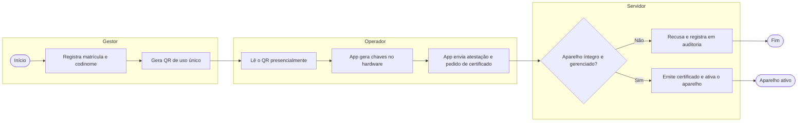
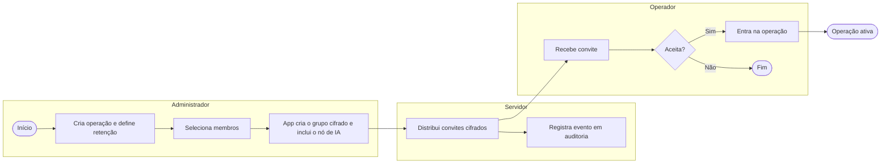
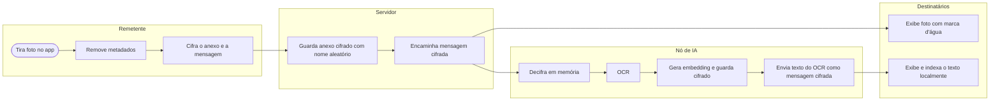
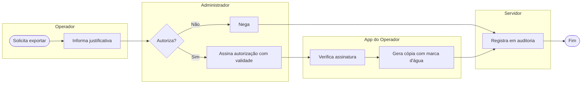
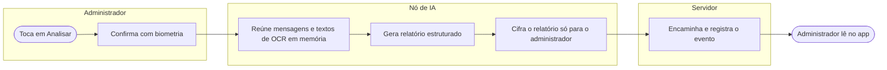
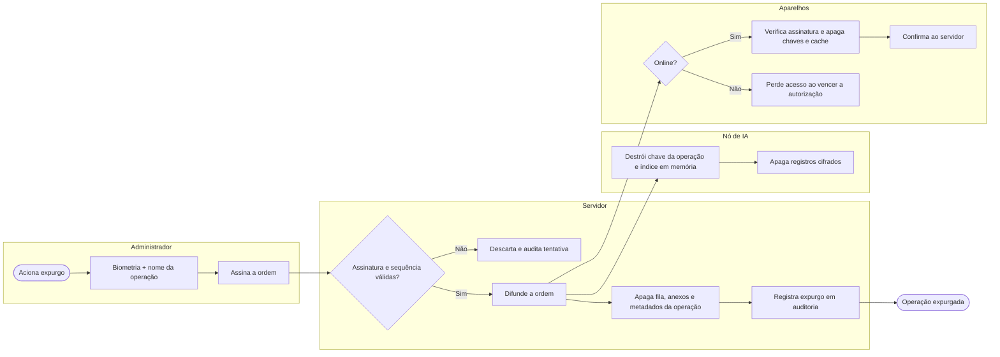

# 01 — Negócio e Requisitos

**Projeto:** Mensageiro Tático (nome provisório)
**Versão do documento:** 0.1 — rascunho para validação
**Público:** patrocinador do projeto, chefia da unidade de inteligência, jurídico/corregedoria, equipe de desenvolvimento

> Documentos relacionados: `02-arquitetura-engenharia.md` (como construir) e `03-seguranca-homologacao-roadmap.md` (como provar que está seguro e em que ordem entregar).

---

## 1. Problema e objetivo

**Problema.** A equipe de inteligência usa o WhatsApp para coordenar operações. Isso tem gerado vazamento de dados e de capturas de tela, porque o aplicativo:

- vincula a identidade ao número de telefone (SIM swap, exposição do número pessoal);
- guarda histórico no aparelho e em backups de nuvem fora do controle da instituição;
- permite print, encaminhamento e download livre de anexos;
- não oferece ao responsável pela operação nenhum controle sobre o ciclo de vida das conversas.

**Objetivo.** Um aplicativo de mensagens institucional, cifrado ponta a ponta, sem histórico permanente, em que o administrador da operação controla retenção, exportação e destruição dos dados, e em que cada vazamento seja dificultado e, quando ocorrer, atribuível a um usuário.

**O que o projeto não promete.** Nenhum software impede que alguém fotografe a tela com outro aparelho ou copie à mão o que leu. O projeto reduz a superfície de vazamento, desencoraja e permite atribuir a origem. Essa limitação precisa estar clara para o patrocinador desde o início.

---

## 2. Decisões já tomadas

| # | Decisão | Motivo |
|---|---|---|
| D1 | App nativo via Capacitor, **não PWA** | Bloqueio de captura, detecção de depuração e chaves em hardware só existem em app instalado |
| D2 | **Android gerenciado** (MDM) na v1; iOS em fase posterior | No iOS só é possível detectar captura, não bloquear |
| D3 | Identidade **sem número de telefone**: chave gerada no hardware do aparelho, cadastro presencial por QR, vínculo com matrícula | Elimina SIM swap e exposição do número pessoal |
| D4 | Cifra ponta a ponta com **MLS (RFC 9420)** e AES-256-GCM | Grupos/canais grandes com remoção eficiente de membros; biblioteca auditada em vez de protocolo próprio |
| D5 | IA roda em **nó on-premises declarado como membro da sala** | É a única forma honesta de ter OCR, busca semântica e análise sem quebrar a cifra em segredo |
| D6 | Correção de texto **sob demanda**; sem autocompletar a cada tecla na v1 | Autocompletar no servidor exporia cada tecla digitada |
| D7 | Expurgo por **destruição de chaves** (crypto-shredding), não só por exclusão de registros | Exclusão em banco deixa resíduos em disco, WAL e backups |
| D8 | **Trilha de auditoria selada de metadados** (sem conteúdo) | Sem ela, corregedoria e jurídico tendem a barrar a homologação |
| D9 | PostgreSQL como único banco; sem OpenSearch | Menos componentes dentro do perímetro |

---

## 3. Brainstorm

### 3.1 Ideias adotadas

- Estrutura tipo Discord: **Operação → Canais → Mensagens**, com tela de conversa simples no estilo WhatsApp/Telegram.
- Convite por **QR de uso único**, com validade de poucos minutos, lido presencialmente.
- **Marca d'água forense** em toda a tela de conversa e em todo anexo exibido (codinome + identificador do aparelho + hora).
- **Foto com OCR automático**: ao enviar uma foto, o texto extraído acompanha a mensagem e passa a ser pesquisável.
- **Busca textual rápida no aparelho**, sobre o que está no cache local cifrado.
- **Botão "Analisar operação"** exclusivo do administrador: resumo, linha do tempo, riscos.
- **Anexos apenas para visualização**; exportar exige autorização assinada do administrador.
- **Kill-switch**: o administrador apaga a operação e tudo ligado a ela é destruído.
- **Chaves com prazo de validade**: aparelho que fica offline além do prazo perde acesso sozinho.

### 3.2 Ideias para avaliar depois

- Autocompletar de próxima palavra com modelo pequeno **rodando no próprio aparelho**.
- Expurgo com **dupla custódia** (duas assinaturas) para operações sensíveis.
- Mensagem de voz com transcrição local.
- Modo "sala de leitura": conteúdo só aparece enquanto o dedo está na tela.
- Cliente desktop em estação gerenciada.

### 3.3 Ideias descartadas

| Ideia | Por que saiu |
|---|---|
| Identificação por número de telefone | SIM swap, interceptação de SMS, expõe o número pessoal |
| AES-128 | Sem ganho prático frente ao AES-256; padrão institucional pede 256 |
| PWA puro | Não bloqueia captura nem acessa hardware seguro |
| OpenSearch junto com PostgreSQL | Duplica dados sensíveis em dois motores |
| Embeddings em claro com índice permanente | Permitem reconstruir boa parte do conteúdo original |
| Configurar o banco para "não alertar monitoramento" | Expurgo em órgão público precisa ser auditável, não invisível |

### 3.4 Construir ou adaptar

Antes de iniciar a Fase 1, vale registrar uma comparação com adaptar uma base existente (Matrix/Element, Wire ou similar). A parte cara e arriscada do projeto é a criptografia e sua auditoria, não a tela de chat. A recomendação deste documento é construir o produto próprio **usando biblioteca MLS auditada**, porque os requisitos de expurgo, marca d'água, controle de exportação e nó de IA não existem prontos. Essa escolha deve ser confirmada no spike da Fase 0.

---

## 4. Atores e papéis

| Papel | Quem é | Pode |
|---|---|---|
| **Gestor do sistema** | Responsável institucional pela plataforma | Cadastrar e revogar usuários e aparelhos; criar administradores de operação. Não lê conteúdo |
| **Administrador de operação** | Chefe da operação | Criar operação e canais; convidar e remover membros; definir retenção; autorizar exportação; pedir análise de IA; acionar expurgo |
| **Operador** | Agente da equipe | Enviar e ler mensagens e anexos; buscar; pedir correção de texto |
| **Auditor** | Corregedoria / controle interno | Consultar a trilha de metadados. Não lê conteúdo |
| **Nó de IA** | Serviço on-premises | Membro técnico da sala; processa OCR, embeddings, correção e análise. Sempre visível na lista de membros |

---

## 5. Regras de negócio

| ID | Regra |
|---|---|
| RN01 | Toda mensagem e todo anexo são cifrados no aparelho do remetente. O servidor de mensagens nunca tem acesso a texto em claro. |
| RN02 | O servidor guarda apenas mensagens cifradas **ainda não entregues**, por prazo máximo configurável (padrão: 72 h). Entregue ou vencido, o registro é apagado. |
| RN03 | Cada operação tem uma política de retenção definida pelo administrador na criação (ex.: 24 h, 7 dias, até o encerramento). Vencido o prazo, o conteúdo some do aparelho e do nó de IA. |
| RN04 | Quando o administrador apaga a operação, são destruídos: chaves da operação, mensagens em cache nos aparelhos, anexos, textos de OCR, embeddings e relatórios de IA. Permanece somente o registro de auditoria de que a operação existiu e foi expurgada. |
| RN05 | Um usuário só entra no sistema por cadastro presencial feito pelo gestor, com QR de uso único e vínculo à matrícula. |
| RN06 | Um usuário só entra em uma operação por convite do administrador daquela operação. |
| RN07 | Anexos são exibidos dentro do app. Salvar fora do app exige autorização do administrador, individual por arquivo e por usuário, com validade. A cópia exportada leva marca d'água e a exportação é registrada. |
| RN08 | O app não abre conteúdo se o aparelho estiver em estado inseguro (ver RNF-D). O evento é registrado e o administrador é avisado. |
| RN09 | Relatórios de análise de IA são visíveis apenas ao administrador da operação. Todos os membros sabem que o nó de IA participa da sala. |
| RN10 | Aparelho que não renova sua autorização dentro do prazo (padrão: 12 h) perde acesso ao cache local, mesmo sem receber ordem de expurgo. |
| RN11 | A trilha de auditoria registra quem, quando e o quê em nível de evento (cadastro, convite, remoção, exportação, alerta de integridade, expurgo). Nunca registra conteúdo de mensagem. |
| RN12 | Remoção de um membro troca as chaves da sala; o removido não lê nada do que for enviado depois. |
| RN13 | Copiar e colar texto para fora do app é bloqueado. Notificações do sistema não exibem conteúdo. |

---

## 6. Requisitos funcionais

### 6.1 Identidade e acesso

| ID | Requisito | Prioridade |
|---|---|---|
| RF01 | Cadastro de aparelho por QR de uso único, com geração de chaves no hardware seguro e atestação do aparelho | Essencial |
| RF02 | Desbloqueio do app por biometria ou PIN a cada abertura e após inatividade | Essencial |
| RF03 | Exibição de codinome; matrícula e nome real nunca trafegam nas salas | Essencial |
| RF04 | Verificação entre membros por código de segurança (comparação presencial ou por QR) | Importante |
| RF05 | Revogação imediata de aparelho pelo gestor | Essencial |

### 6.2 Operações, canais e mensagens

| ID | Requisito | Prioridade |
|---|---|---|
| RF10 | Criar operação com política de retenção e lista inicial de membros | Essencial |
| RF11 | Criar canais dentro da operação (ex.: geral, campo, análise) | Essencial |
| RF12 | Enviar e receber texto em tempo real, com confirmação de entrega e leitura | Essencial |
| RF13 | Enviar foto tirada no app, sem passar pela galeria do aparelho | Essencial |
| RF14 | Enviar documento e áudio | Importante |
| RF15 | Responder, mencionar e reagir a mensagens | Desejável |
| RF16 | Apagar mensagem para todos (remetente ou administrador) | Importante |
| RF17 | Mensagem com prazo próprio de autodestruição, menor que o da operação | Desejável |

### 6.3 Anexos e controle de exportação

| ID | Requisito | Prioridade |
|---|---|---|
| RF20 | Visualizador interno de imagens, PDF e áudio, sem gravar arquivo em área compartilhada | Essencial |
| RF21 | Pedido de exportação pelo operador e aprovação/negação pelo administrador | Essencial |
| RF22 | Marca d'água visível em tela e em anexos; marca invisível em imagens exportadas | Essencial |
| RF23 | Remoção de metadados (GPS, modelo do aparelho, hora do sensor) antes do envio | Essencial |

### 6.4 Busca e OCR

| ID | Requisito | Prioridade |
|---|---|---|
| RF30 | Busca textual instantânea no cache local do aparelho | Essencial |
| RF31 | OCR automático de fotos enviadas; texto extraído anexado à mensagem para todos os membros | Essencial |
| RF32 | Busca semântica por significado dentro da operação, respondida pelo nó de IA | Importante |

### 6.5 Assistência de IA

| ID | Requisito | Prioridade |
|---|---|---|
| RF40 | Botão "Corrigir texto" no campo de digitação; mostra sugestão e o usuário aceita ou descarta | Essencial |
| RF41 | "Interpretar/explicar" uma mensagem ou trecho, a pedido do usuário | Importante |
| RF42 | "Analisar operação" (somente administrador): resumo executivo, linha do tempo, entidades citadas, riscos e recomendações | Essencial |
| RF43 | Relatório de análise exibido apenas no app, sujeito à mesma retenção e expurgo | Essencial |
| RF44 | Aviso permanente de que o relatório é apoio à decisão e pode conter erros | Essencial |

### 6.6 Expurgo e auditoria

| ID | Requisito | Prioridade |
|---|---|---|
| RF50 | Expurgo da operação por ordem assinada pelo administrador, verificada por cada aparelho | Essencial |
| RF51 | Confirmação reforçada antes do expurgo (biometria + digitar o nome da operação) | Essencial |
| RF52 | Painel do administrador com situação do expurgo por aparelho (confirmado / pendente / expirará por prazo) | Importante |
| RF53 | Consulta à trilha de auditoria pelo perfil Auditor | Essencial |
| RF54 | Expurgo com dupla custódia, configurável por operação | Desejável |

---

## 7. Requisitos não funcionais

### A. Criptografia

| ID | Requisito |
|---|---|
| RNF-A1 | Cifra ponta a ponta de grupo com MLS (RFC 9420), implementação auditada, executada em código nativo |
| RNF-A2 | Cifra simétrica AES-256-GCM (ou ChaCha20-Poly1305); assinaturas Ed25519; troca de chaves X25519 |
| RNF-A3 | Chaves privadas de identidade geradas e mantidas em hardware seguro (StrongBox/TEE), não exportáveis |
| RNF-A4 | Sigilo futuro e recuperação pós-comprometimento garantidos pelo protocolo |
| RNF-A5 | Anexos cifrados no aparelho com chave própria por arquivo antes do envio |

### B. Transporte e servidor

| ID | Requisito |
|---|---|
| RNF-B1 | TLS 1.3 com autenticação mútua; certificado do cliente emitido no cadastro, com chave em hardware |
| RNF-B2 | Fixação de certificado (pinning) no app |
| RNF-B3 | Servidor de mensagens não registra conteúdo, nem em log |
| RNF-B4 | Toda a infraestrutura on-premises ou em nuvem privada da instituição; nó de IA sem saída para a internet |

### C. Armazenamento

| ID | Requisito |
|---|---|
| RNF-C1 | Cache local em banco cifrado; chave composta por parte em hardware e parte entregue pelo servidor a cada sessão |
| RNF-C2 | Backup do sistema operacional desativado para os dados do app |
| RNF-C3 | Nomes de objetos no armazenamento de anexos são aleatórios, sem relação com operação, usuário ou arquivo |
| RNF-C4 | Texto de OCR, trechos e embeddings ficam cifrados em repouso com chave da operação |

### D. Integridade do aparelho

| ID | Requisito |
|---|---|
| RNF-D1 | Bloqueio de captura e gravação de tela; conteúdo oculto na lista de apps recentes |
| RNF-D2 | Detecção de: depuração USB/sem fio, opções de desenvolvedor, root, bootloader desbloqueado, emulador, instrumentação (Frida/Xposed) |
| RNF-D3 | Detecção de: serviços de acessibilidade não autorizados, projeção/espelhamento de tela, sobreposições, apps de acesso remoto, tela externa |
| RNF-D4 | Atestação do aparelho validada no servidor no cadastro e periodicamente |
| RNF-D5 | Em estado inseguro: conteúdo oculto, sessão encerrada, evento auditado |

### E. Desempenho e disponibilidade

| ID | Requisito | Meta inicial |
|---|---|---|
| RNF-E1 | Entrega de mensagem de texto | ≤ 500 ms no percentil 95, em rede 4G |
| RNF-E2 | Busca local | ≤ 200 ms |
| RNF-E3 | OCR de uma foto | ≤ 5 s |
| RNF-E4 | Correção de texto | ≤ 3 s |
| RNF-E5 | Relatório de análise | ≤ 60 s |
| RNF-E6 | Propagação do expurgo a aparelhos online | ≤ 10 s |
| RNF-E7 | Disponibilidade do serviço de mensagens | 99,5% |

As metas são ponto de partida para validar com a unidade; nenhuma foi medida ainda.

### F. Usabilidade

| ID | Requisito |
|---|---|
| RNF-F1 | Tela de conversa no padrão WhatsApp/Telegram; operador novo envia a primeira mensagem sem treinamento |
| RNF-F2 | Tema escuro como padrão; uso com uma mão |
| RNF-F3 | Indicadores discretos e permanentes: estado de segurança do aparelho, presença do nó de IA, prazo de retenção |

---

## 8. Processos (BPMN simplificado)

Os diagramas usam Mermaid. Raias são representadas por subgrafos.

### 8.1 Cadastro de usuário e aparelho

### 8.2 Criação de operação e convite

### 8.3 Envio de foto com OCR

### 8.4 Pedido de exportação de anexo

### 8.5 Análise da operação por IA

### 8.6 Expurgo da operação

---

## 9. Governança e conformidade

Este item precisa de validação do jurídico da instituição; o texto abaixo é ponto de partida, não parecer.

- **Base normativa do uso.** Definir o ato interno que autoriza a ferramenta, quem pode ser administrador de operação e quem responde pelo expurgo.
- **LGPD.** O tratamento para segurança pública e investigação tem regime próprio (art. 4º, III), mas os princípios gerais e o devido processo continuam aplicáveis. Registrar finalidade, retenção e responsáveis.
- **Cadeia de custódia.** O sistema é canal de coordenação, não repositório de prova. Informação que precise integrar procedimento formal deve ser levada ao sistema oficial pelo fluxo de exportação autorizada. Isso deve constar na norma de uso.
- **Controle.** A trilha de metadados existe para que corregedoria e controle externo possam verificar *que* houve uma operação, quem participou e quem a encerrou, sem acesso ao conteúdo.
- **Uso da IA.** Relatórios são apoio à decisão. Não substituem análise humana e não devem ser citados como fonte em documento oficial.
- **Transparência interna.** Todo membro é informado, no convite, de que há nó de IA na sala e de que o administrador pode pedir análise do conteúdo.

---

## 10. Critérios de sucesso

| Critério | Como verificar |
|---|---|
| A unidade abandona o WhatsApp para operações | Uso semanal por 90% da equipe após 60 dias de piloto |
| Captura de tela e gravação não funcionam em aparelho homologado | Checklist do documento 03 |
| Vazamento por foto de tela é atribuível | Teste cego: identificar o aparelho de origem a partir de uma foto |
| Expurgo não deixa conteúdo recuperável | Teste forense de aparelho e de servidor após expurgo |
| Servidor comprometido não revela conteúdo | Pentest com acesso total ao servidor de mensagens |
| Homologação pela área de segurança da instituição | Parecer formal |

---

## 11. Pontos em aberto

1. Modelos de aparelho e solução de MDM disponíveis na instituição.
2. Prazo padrão de retenção e de renovação de autorização (propostos: 7 dias e 12 h).
3. Hardware do nó de IA (GPU) e local de hospedagem.
4. Necessidade de dupla custódia para expurgo.
5. Quem exerce o papel de Auditor e com que rito acessa a trilha.
6. Volume esperado: usuários, operações simultâneas, fotos por dia.
7. Necessidade de operação em área sem cobertura (modo offline e seus limites).
