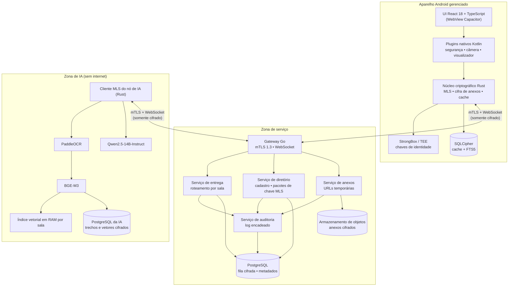
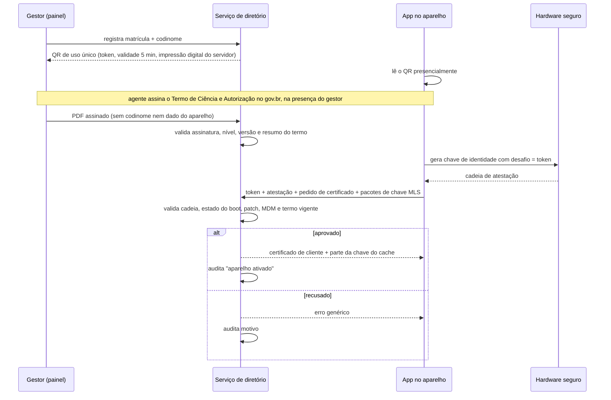
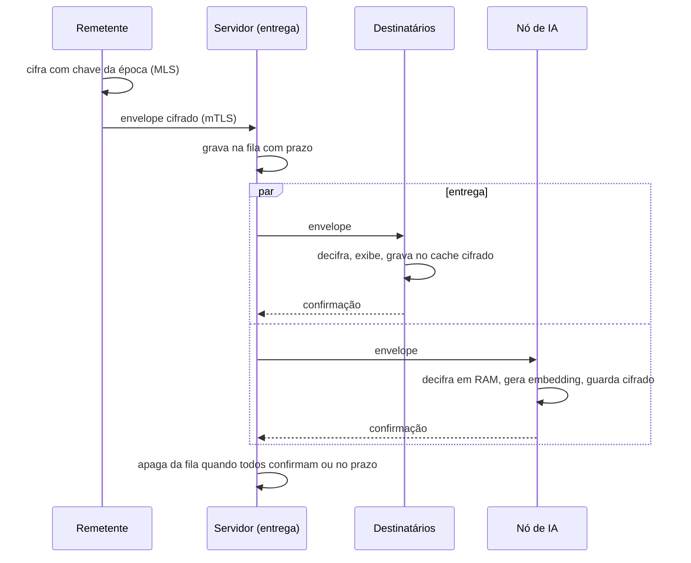
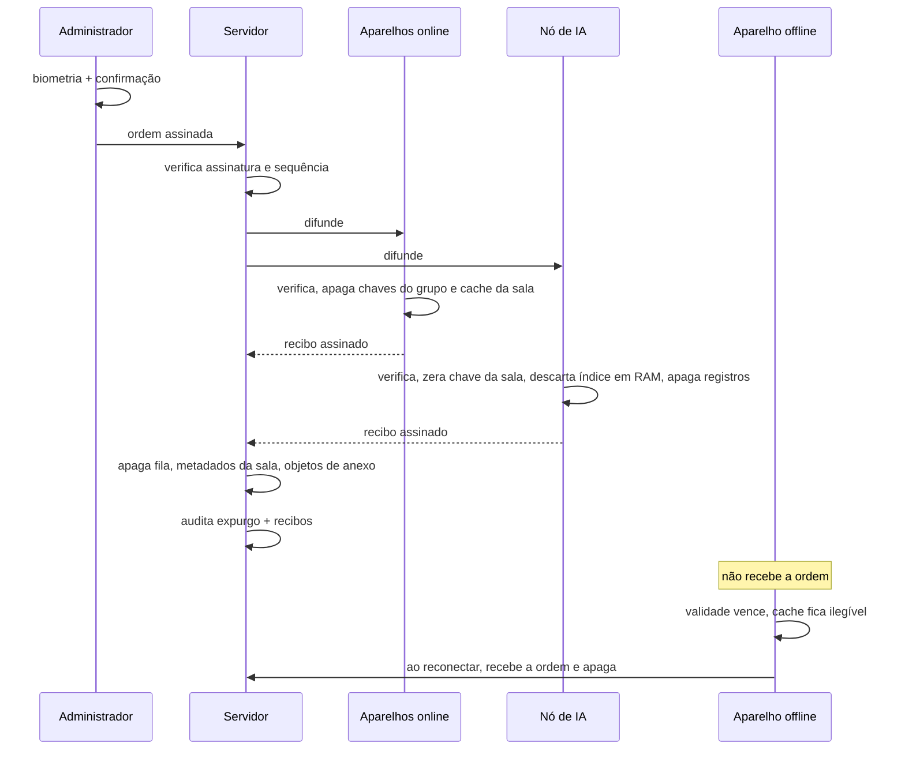

# 02 — Arquitetura e Engenharia

**Projeto:** MIGDOL
**Versão do documento:** 0.2 — rascunho para validação
**Público:** equipe de desenvolvimento e revisores de segurança

> Este documento substitui os trechos de código dos rascunhos anteriores. A seção 12 lista o que foi corrigido e por quê. Versões de bibliotecas devem ser confirmadas na Fase 0; nada aqui foi compilado ou testado ainda.

---

## 1. Princípios

1. **O servidor de mensagens é tratado como hostil.** Só vê texto cifrado e metadados mínimos.
2. **Só existe um lugar fora dos aparelhos onde há texto em claro: o nó de IA**, e apenas em memória. Ele é membro declarado da sala.
3. **Apagar é destruir chave.** Exclusão de registros é complemento.
4. **Criptografia não é escrita à mão.** Protocolo e primitivas vêm de bibliotecas auditadas; nosso código faz orquestração.
5. **Segredos ficam em código nativo e hardware.** A camada web (React) nunca toca em chave privada.
6. **Toda defesa no aparelho é contornável por quem controla o aparelho.** Por isso há atestação no servidor, marca d'água e prazos de validade.

---

## 2. Visão geral



O nó de IA conecta-se ao gateway como qualquer cliente. Não há caminho de rede direto entre o serviço de entrega e os modelos.

---

## 3. Pilha tecnológica

| Camada | Escolha | Observação |
|---|---|---|
| Interface | React 18, TypeScript, Tailwind, Vite | Estado com Zustand; lista virtualizada para a conversa |
| Casca nativa | Capacitor (versão estável corrente) | Somente Android na v1 |
| Plugins nativos | Kotlin | Segurança do aparelho, câmera interna, visualizador de anexos, ponte para o núcleo |
| Núcleo criptográfico | Rust, exposto por JNI (UniFFI) | OpenMLS como candidata; confirmar no spike |
| Cache local | SQLCipher com FTS5 | Busca textual local |
| Backend | Go | `net/http`, biblioteca WebSocket mantida, `pgx/v5` |
| Banco do backend | PostgreSQL | Sem conteúdo em claro |
| Anexos | Armazenamento compatível com S3, on-premises | MinIO, SeaweedFS ou Garage — verificar situação de licença e manutenção de cada um antes de escolher |
| OCR | PaddleOCR (modelo para português) | Tesseract como reserva |
| Embeddings | `BAAI/bge-m3`, 1024 dimensões | Multilíngue; não usa prefixo de instrução |
| LLM | `Qwen/Qwen2.5-14B-Instruct` | Ver dimensionamento na seção 9 |
| Servidor de inferência | vLLM (pesos AWQ) **ou** llama.cpp (GGUF) | Um ou outro; os formatos não se misturam |
| Gestão de aparelhos | Android Enterprise via MDM da instituição | Distribuição privada do app |

---

## 4. Identidade e cadastro

### 4.1 Chaves por aparelho

| Chave | Algoritmo | Onde fica | Uso |
|---|---|---|---|
| Identidade do aparelho | EC P-256 em StrongBox/TEE | Hardware, não exportável | Atestação e certificado mTLS |
| Assinatura MLS | Ed25519 | Núcleo Rust, embrulhada por chave do Keystore | Credencial no grupo |
| Assinatura de administrador | Ed25519 | Idem, uso condicionado a biometria | Ordens de expurgo e autorizações de exportação |
| Chave do cache local | 256 bits | Derivada (ver 4.3) | SQLCipher |

A chave de identidade usa P-256 porque é o que o hardware seguro do Android suporta de forma ampla com atestação. As chaves Ed25519 ficam fora do hardware, mas embrulhadas por uma chave AES que só existe nele.

### 4.2 Fluxo de cadastro



O servidor de diretório conhece o vínculo matrícula ↔ aparelho. As salas só conhecem o codinome.

### 4.3 Chave do cache local e validade (lease)

```
chave_cache = HKDF( segredo_hardware , segredo_servidor , "cache-v1" )
```

- `segredo_hardware`: liberado pelo Keystore após biometria/PIN.
- `segredo_servidor`: entregue a cada sessão autenticada, mantido só em memória, com validade (padrão 12 h).

Consequências: aparelho revogado ou offline além do prazo não consegue mais abrir o cache, mesmo que a ordem de expurgo nunca chegue. O app também apaga o cache ao detectar validade vencida.

---

## 5. Protocolo de mensagens

### 5.1 Por que MLS

Em canais com dezenas de membros, cifrar par a par (Double Ratchet) custa uma operação por destinatário e torna a remoção de membro cara. O MLS mantém uma chave de grupo em árvore, com custo logarítmico, sigilo futuro e troca de chaves a cada mudança de membros.

### 5.2 Mapeamento

| Conceito do produto | No protocolo |
|---|---|
| Operação | Um grupo MLS |
| Canal | Rótulo dentro do conteúdo cifrado (v1). Canais com membros diferentes viram grupos separados (v2) |
| Entrar / sair | Commit de inclusão / remoção; nova época de chaves |
| Nó de IA | Membro comum, com credencial marcada como "serviço" |
| Administrador | Papel verificado pelos clientes: só aceitam commits e ordens assinados por chave de administrador registrada na criação do grupo |

### 5.3 Envelope

O servidor vê apenas:

```
room_id      : identificador aleatório de 128 bits (sem significado)
epoch        : época MLS
sender_leaf  : cifrado pelo MLS (remetente oculto do servidor)
ciphertext   : mensagem MLS
expires_at   : prazo de descarte na fila
```

Conteúdo cifrado (CBOR):

```
type     : text | attachment | ocr_result | ai_request | ai_response | export_grant | control
channel  : rótulo do canal
body     : conforme o tipo
sent_at  : hora do remetente
ttl      : autodestruição, se houver
```

### 5.4 Anexos

1. O app gera chave aleatória de 256 bits e cifra o arquivo com AES-256-GCM em blocos.
2. Pede ao serviço de anexos uma URL temporária de envio; o nome do objeto é um identificador aleatório.
3. Envia o arquivo cifrado.
4. Publica na sala uma mensagem `attachment` com: identificador do objeto, chave, hash e tipo.

O armazenamento nunca recebe a chave. Cifra no lado do servidor (SSE) pode ficar ligada como camada extra, mas não é a proteção principal.

---

## 6. Fluxo criptográfico e de expurgo

### 6.1 Mensagem de texto



### 6.2 Ordem de expurgo

Formato assinado (binário, campos de tamanho fixo ou com prefixo de comprimento, sem JSON):

```
"MT-EXPUNGE-v1" | room_id (16) | seq (8) | issued_at (8) | reason (1) | admin_key_id (32)
assinatura Ed25519 (64) sobre todos os bytes acima
```

Regras:

- `seq` é um contador crescente por sala. Aparelhos e servidor rejeitam valor menor ou igual ao último visto. Isso substitui cache de nonces e sobrevive a reinício.
- **Ordem de verificação no servidor:** tamanho → administrador conhecido para a sala → assinatura → janela de tempo → sequência. Nenhum estado é gravado antes de a assinatura passar.
- **Cada aparelho verifica a assinatura por conta própria**, contra a chave de administrador que recebeu na criação do grupo. Um servidor comprometido não consegue forjar expurgo.
- Com dupla custódia ativa, a ordem leva duas assinaturas de administradores distintos.



### 6.3 O que é destruído e como

| Dado | Onde | Método |
|---|---|---|
| Chaves do grupo MLS | Aparelhos, nó de IA | Remoção do estado do grupo |
| Cache de mensagens | SQLCipher no aparelho | Exclusão das linhas + chave da sala descartada; a base inteira já é ilegível sem o lease |
| Fila cifrada | PostgreSQL do backend | Exclusão; já era ilegível para o servidor |
| Anexos cifrados | Armazenamento de objetos | Exclusão; chaves só existiam nas mensagens |
| Trechos, OCR e vetores | PostgreSQL da IA | Chave da sala destruída + exclusão da partição |
| Índice vetorial | RAM do nó de IA | Descartado |
| Relatórios de IA | Cache do administrador | Como o cache |
| Trilha de auditoria | PostgreSQL do backend | **Permanece** (sem conteúdo) |

Limite conhecido: memória de processo em Go, Python e JavaScript não pode ser zerada com garantia, por causa do coletor de lixo. Chaves sensíveis ficam no núcleo Rust, em memória travada e zerada de forma explícita. Para o restante, a proteção é não persistir e reiniciar o processo do nó de IA após o expurgo.

---

### 6.4 O que o sistema pode e não pode entregar a uma ordem externa

| Existe e pode ser entregue por rito | Não existe (por desenho) |
|---|---|
| Mensagens cifradas armazenadas e anexos cifrados | Conteúdo em claro de mensagens (regra 3) |
| Metadados que o servidor precisa para entregar (sala em forma opaca, horário, tamanho, estado dos aparelhos) conforme a seção 7.5 | Chaves privadas e de sessão (regra 2; só no core) |
| Registros de auditoria, aceites do termo, status e revogação de aparelhos | Cliente web, segundo aparelho ou vínculo de espelhamento |
| Registro de visualização, alertas e cópia de custódia, cifrados para a chave de quórum (ADR-0003); só abertos por no mínimo 3 comandantes | Interceptação em trânsito: tudo é mTLS 1.3 com MLS por cima |

Observações:
- O nó de IA vê texto em claro na RAM como **membro declarado** da sala; é um ponto a incluir no parecer, pois uma ordem ao nó atingiria a instituição, não um terceiro.
- Material de evidência sai como **pacote assinado** (RF67), não como captura de tela.
- Apreensão de aparelho por autoridade: o padrão é suspender e revogar, sem expurgo remoto, até a decisão D-R14 (escada de resposta: doc 07 seção 7.1).
- **Não existe hoje arquivo institucional nem reenvio de histórico a aparelho revinculado** (um aparelho novo em MLS não lê épocas anteriores). A ADR-0003 (proposta) cria a cópia de custódia por sala e período, aberta só por quórum de 3 comandantes. A proposta de arquivo custodiado, aberto só por ordem judicial, está no doc 07 seção 7.3 (D-R15) e depende de ADR-0003.

## 7. Backend em Go

### 7.1 Serviços

| Serviço | Responsabilidade | Não faz |
|---|---|---|
| **Gateway** | Termina mTLS 1.3, valida certificado e situação do aparelho, mantém WebSocket, limita taxa | Não interpreta conteúdo |
| **Entrega** | Roteia envelopes por sala, mantém fila com prazo, coleta confirmações | Não conhece remetente nem conteúdo |
| **Diretório** | Cadastro, atestação, pacotes de chave MLS, membros por sala, leases | Não participa dos grupos |
| **Anexos** | Emite URLs temporárias, controla cota e expiração | Não tem chaves |
| **Auditoria** | Grava eventos em cadeia de hash; serve o perfil Auditor | Não recebe conteúdo |

Na v1 rodam num único binário, mas cada serviço é um **módulo Go independente** (ADR-11): contrato público em `api/`, implementação em `internal/`, tabelas e migrações próprias. Os serviços só se falam por contrato, segundo um grafo fixo:

| Serviço | Pode depender de |
|---|---|
| audit | — |
| directory | audit |
| delivery | directory, audit |
| blobs | directory |
| gateway | directory, delivery |

`scripts/check-boundaries.sh` verifica o grafo. Separar em processos quando houver necessidade operacional, seguindo `docs/MIGRACAO-MICROSSERVICOS.md`.

### 7.2 Estrutura do repositório

```
MIGDOL/
├── CLAUDE.md                 # regras do projeto (+ um CLAUDE.md por componente)
├── docs/
│   ├── adr/                  # decisões novas (ADR-0001 em diante)
│   └── MIGRACAO-MICROSSERVICOS.md
├── scripts/
│   └── check-boundaries.sh   # verifica o grafo de dependências do server/
├── app/                      # React + Capacitor
│   ├── src/
│   └── android/
│       └── plugins/
│           ├── security/     # integridade do aparelho
│           ├── camera/
│           └── viewer/
├── core/                     # Rust: MLS, cifra de anexos, cache
├── server/                   # Go: monólito modular (go.work)
│   ├── cmd/server/           # composição: liga implementações aos contratos
│   ├── platform/ids/         # único código compartilhado (identificadores)
│   └── services/
│       ├── gateway/
│       ├── delivery/
│       ├── directory/
│       ├── blobs/
│       └── audit/            # cada serviço: api/, internal/, migrations/, go.mod, CLAUDE.md
├── ai-node/                  # Python + cliente Rust
│   ├── client/
│   ├── ocr/
│   ├── embed/
│   ├── llm/
│   └── index/
├── admin-panel/              # painel do gestor
├── deploy/
└── tests/
    ├── integration/
    └── security/
```

### 7.3 Gateway: pontos obrigatórios

- `ClientAuth: RequireAndVerifyClientCert`, TLS 1.3 apenas, autoridade certificadora própria do projeto.
- Após o handshake: extrair o identificador do aparelho do certificado, conferir se está ativo e com lease válido.
- Verificação de `Origin` explícita (o rascunho anterior aceitava qualquer origem).
- Um escritor por conexão (goroutine dedicada com canal de saída limitado); cliente lento é desconectado, não trava os demais.
- Limites: tamanho máximo de envelope, mensagens por segundo por aparelho, conexões por aparelho.
- Logs sem corpo de mensagem e sem `room_id` em claro (usar hash com sal rotativo para correlação operacional).

### 7.4 Entrega: esqueleto

```go
// Estrutura ilustrativa — não é código final. No código real, `dir` é a interface
// directory/api.Directory e a fila pertence ao pacote delivery (ADR-11).
type Room struct {
    mu      sync.RWMutex
    members map[DeviceID]*Conn
}

type Hub struct {
    mu    sync.RWMutex
    rooms map[RoomID]*Room
    dir   Directory   // quem pertence a qual sala
    queue Queue       // fila cifrada com prazo
}

func (h *Hub) Publish(ctx context.Context, from DeviceID, env Envelope) error {
    if !h.dir.IsMember(ctx, env.RoomID, from) {
        return ErrForbidden            // autorização por sala em toda publicação
    }
    if err := h.queue.Put(ctx, env); err != nil {
        return err                     // grava antes de difundir
    }
    for _, c := range h.room(env.RoomID).snapshot() {
        c.TrySend(env)                 // não bloqueia; fila cobre quem perdeu
    }
    return nil
}
```

Diferenças em relação ao rascunho anterior: há salas, há autorização por sala, a difusão não trava em cliente lento e a entrega a quem está offline vem da fila.

### 7.5 Modelo de dados do backend

```sql
-- Sem conteúdo em claro em nenhuma tabela.
-- Cada serviço é dono das suas tabelas (migrations/ do serviço):
--   directory: users, devices, rooms, memberships, key_packages, terms, term_acceptances
--   delivery:  outbox, outbox_pending
--   blobs:     blobs
--   audit:     audit_log
-- Não há chave estrangeira entre serviços: room_id em outbox e blobs é uuid simples,
-- e o expurgo limpa por chamada ou evento, não por ON DELETE CASCADE (ADR-11).
-- Os trechos abaixo mantêm as REFERENCES entre tabelas do mesmo serviço apenas.
CREATE TABLE users (
    user_id      uuid PRIMARY KEY,
    registration text NOT NULL UNIQUE,      -- matrícula
    codename     text NOT NULL UNIQUE,
    role         text NOT NULL,             -- gestor | operador | auditor
    created_at   timestamptz NOT NULL DEFAULT now(),
    revoked_at   timestamptz
);

CREATE TABLE devices (
    device_id     uuid PRIMARY KEY,
    user_id       uuid NOT NULL REFERENCES users,
    cert_fpr      bytea NOT NULL UNIQUE,
    attestation   jsonb NOT NULL,           -- resumo validado, sem segredos
    lease_until   timestamptz,
    status        text NOT NULL,            -- pending_term | active | suspended | revoked
    last_seen_at  timestamptz
);

CREATE TABLE rooms (
    room_id        uuid PRIMARY KEY,        -- aleatório, sem significado
    admin_keys     bytea[] NOT NULL,        -- chaves públicas Ed25519
    retention_secs integer NOT NULL,
    expunge_seq    bigint NOT NULL DEFAULT 0,
    dual_custody   boolean NOT NULL DEFAULT false,
    created_at     timestamptz NOT NULL DEFAULT now()
);
-- O nome da operação NÃO fica aqui: vive dentro do estado cifrado do grupo.

CREATE TABLE memberships (
    room_id   uuid REFERENCES rooms ON DELETE CASCADE,
    device_id uuid REFERENCES devices,
    PRIMARY KEY (room_id, device_id)
);

CREATE TABLE key_packages (
    id         uuid PRIMARY KEY,
    device_id  uuid NOT NULL REFERENCES devices,
    package    bytea NOT NULL,
    claimed_at timestamptz
);

-- Termo de Ciência e Autorização (dono: directory). Ver docs/anexos e docs/06 seção 7.
CREATE TABLE terms (
    version      text PRIMARY KEY,
    text_sha256  bytea NOT NULL,
    published_at timestamptz NOT NULL,
    retired_at   timestamptz
);
CREATE TABLE term_acceptances (
    user_id       uuid NOT NULL REFERENCES users,
    version       text NOT NULL REFERENCES terms,
    signed_sha256 bytea NOT NULL,           -- hash do PDF assinado (o PDF fica em guarda segura)
    signer_level  text NOT NULL,            -- avançada | qualificada | presencial
    method        text NOT NULL,            -- govbr | icp | presencial
    witness_id    uuid,                     -- testemunha, na via presencial
    provisional_until timestamptz,          -- só via presencial; expira no servidor
    ratified_at   timestamptz,
    signed_at     timestamptz NOT NULL,
    validated_at  timestamptz NOT NULL,
    PRIMARY KEY (user_id, version)
);
-- Estado do aparelho: pending_term (aguardando termo) | active | suspended | revoked.

CREATE TABLE outbox (
    msg_id     uuid PRIMARY KEY,
    room_id    uuid NOT NULL,           -- sem FK: pertence ao diretório
    envelope   bytea NOT NULL,
    expires_at timestamptz NOT NULL
);
CREATE TABLE outbox_pending (
    msg_id    uuid REFERENCES outbox ON DELETE CASCADE,
    device_id uuid,
    PRIMARY KEY (msg_id, device_id)
);

CREATE TABLE blobs (
    object_key text PRIMARY KEY,            -- aleatório
    room_id    uuid NOT NULL,           -- sem FK: pertence ao diretório
    size_bytes bigint NOT NULL,
    expires_at timestamptz NOT NULL
);

CREATE TABLE audit_log (
    seq        bigserial PRIMARY KEY,
    at         timestamptz NOT NULL DEFAULT now(),
    actor      uuid,
    event      text NOT NULL,
    room_ref   bytea,                       -- hash do room_id
    detail     jsonb NOT NULL,
    prev_hash  bytea NOT NULL,
    this_hash  bytea NOT NULL
);
```

Configuração do PostgreSQL: `wal_level` padrão, replicação e backup normais. Como o banco não tem conteúdo legível, não há motivo para degradar a operação.

O papel de banco usado pela aplicação não tem `UPDATE` nem `DELETE` em `audit_log`. O último hash é publicado periodicamente em local externo (ex.: enviado ao Auditor) para que adulteração seja detectável.

---

## 8. Cliente

### 8.1 Divisão de responsabilidades

| Camada | Faz | Nunca faz |
|---|---|---|
| React (WebView) | Renderiza conversa, formulários, navegação | Tocar em chave, gravar em `localStorage`, abrir rede por conta própria |
| Plugins Kotlin | Integridade do aparelho, câmera, visualizador, biometria, ponte | Guardar conteúdo fora do núcleo |
| Núcleo Rust | MLS, cifra, cache SQLCipher, rede (WebSocket + mTLS) | Expor chave pela ponte |

A WebView recebe texto em claro apenas para exibir. Configuração: sem depuração remota em build de produção, sem acesso a arquivos, política de conteúdo restrita ao pacote do app, sem carregamento de origem externa.

### 8.2 Plugin de segurança do aparelho

Contrato exposto à interface:

```ts
interface DeviceSecurity {
  enableScreenProtection(): Promise<void>;
  getIntegrity(): Promise<IntegrityReport>;
  addListener(event: 'integrityChanged', cb: (r: IntegrityReport) => void): Handle;
}

interface IntegrityReport {
  secure: boolean;
  findings: Finding[];   // ex.: 'ADB', 'DEV_OPTIONS', 'ROOT', 'A11Y_UNKNOWN', 'PROJECTION', ...
}
```

Verificações (Kotlin), com a fonte de cada sinal:

| Sinal | Como obter | Ação |
|---|---|---|
| Captura e gravação bloqueadas | `FLAG_SECURE` em todas as janelas, inclusive diálogos e visualizador | Sempre ativo |
| Depuração USB / sem fio | `Settings.Global.ADB_ENABLED`, `adb_wifi_enabled` | Bloqueia |
| Opções de desenvolvedor | `Settings.Global.DEVELOPMENT_SETTINGS_ENABLED` | Bloqueia |
| App depurável ou depurador ligado | `ApplicationInfo.FLAG_DEBUGGABLE`, `Debug.isDebuggerConnected()` | Encerra |
| Root / bootloader | Atestação de chave (estado do boot verificado), **validada no servidor**. Play Integrity **não** é usado (docs/07 seção 8; ADR-0002 proposta) | Bloqueia cadastro e sessão |
| Instrumentação (Frida, Xposed) | Varredura de bibliotecas carregadas e portas conhecidas, feita no núcleo nativo | Encerra |
| Emulador | Propriedades de build + ausência de atestação de hardware | Bloqueia |
| Serviços de acessibilidade | `AccessibilityManager.getEnabledAccessibilityServiceList`, comparado a lista permitida | Bloqueia se fora da lista |
| Projeção / espelhamento | `DisplayManager.getDisplays()` (telas virtuais ou de apresentação); retorno de captura de tela (Android 14+) e de gravação (Android 15+) | Oculta conteúdo e audita |
| Sobreposição de tela | `setHideOverlayWindows(true)` (Android 12+) e filtro de toque obscurecido | Sempre ativo |
| Apps de acesso remoto | Consulta de pacotes contra lista (AnyDesk, TeamViewer, scrcpy-server etc.) | Bloqueia |
| Teclado de terceiros | `InputMethodManager`; exigir teclado permitido pelo MDM | Bloqueia |
| Área de transferência | Campos sem copiar/colar; limpeza ao sair | Sempre ativo |
| Notificações | Sem conteúdo; apenas "nova mensagem" | Sempre ativo |
| Backup | `allowBackup=false`, regras de extração de dados vazias | Sempre ativo |

As verificações rodam na abertura, ao voltar para primeiro plano e de forma periódica enquanto há conteúdo na tela. O resultado é enviado ao servidor; decisões de bloqueio de sessão são do servidor, não só do app.

O MDM complementa: impede instalação de apps fora da lista, desativa depuração, força versão mínima do sistema e permite apagar o perfil de trabalho remotamente. Em aparelho totalmente gerenciado, o desenho prevê apagar o aparelho inteiro por ordem assinada (doc 07 seção 7.4).

### 8.3 Marca d'água

- **Visível:** padrão repetido e semitransparente sobre a conversa e o visualizador, com codinome abreviado, 6 caracteres do identificador do aparelho e data/hora. Desenhado em camada nativa sobre a WebView, para não ser removível pelo DOM.
- **Invisível:** nas imagens exibidas e exportadas, pequena variação por aparelho resistente a recompressão. Técnica a definir e testar na Fase 2; a eficácia contra foto de tela precisa ser medida, não presumida.

### 8.4 Busca local

Tabela FTS5 dentro do SQLCipher, com tokenização para português e remoção de acentos. Indexa texto de mensagens e resultados de OCR. Segue a mesma retenção do cache.

---

## 9. Nó de IA

### 9.1 Papel

Processo único, em rede sem saída para a internet, que:

1. mantém um cliente MLS e participa das salas em que foi incluído;
2. decifra mensagens em memória;
3. executa OCR, embeddings, correção, interpretação e análise;
4. responde por mensagens cifradas na própria sala ou endereçadas a um único membro.

### 9.2 Pedidos e respostas

| Função | Quem pede | Resposta visível para |
|---|---|---|
| OCR de foto | Automático | Todos da sala |
| Correção de texto | Qualquer membro | Só quem pediu |
| Interpretar mensagem | Qualquer membro | Só quem pediu |
| Busca semântica | Qualquer membro | Só quem pediu |
| Análise da operação | Administrador (pedido assinado) | Só o administrador |

Respostas individuais usam mensagem cifrada apenas para a chave do solicitante (HPKE), transportada pelo mesmo canal.

### 9.3 Pipeline de foto

```
anexo cifrado → baixa → decifra em RAM → remove EXIF (defesa em profundidade)
→ pré-processamento (cinza, redução de ruído, correção de inclinação)
→ PaddleOCR (pt) → filtro de confiança
→ texto → mensagem ocr_result para a sala
        → BGE-M3 → vetor → cifra com chave da sala → grava
```

Nada é escrito em disco em claro: contêiner com sistema de arquivos somente leitura, `tmpfs` para temporários, swap desativado.

### 9.4 Armazenamento vetorial

Decisão: **vetores e trechos cifrados em repouso; índice em memória por sala.**

```sql
CREATE TABLE room_keys (
    room_id     uuid PRIMARY KEY,
    wrapped_dek bytea NOT NULL,      -- chave da sala embrulhada pela chave mestra do nó
    kek_version integer NOT NULL
);

CREATE TABLE room_chunks (
    room_id    uuid NOT NULL,
    chunk_id   uuid NOT NULL,
    nonce      bytea NOT NULL,
    ciphertext bytea NOT NULL,       -- trecho + vetor, AES-256-GCM, AAD = room_id || chunk_id
    expires_at timestamptz NOT NULL,
    PRIMARY KEY (room_id, chunk_id)
) PARTITION BY LIST (room_id);
```

- Ao iniciar ou ao entrar numa sala, o nó decifra os vetores e monta o índice em RAM.
- Na escala de uma operação (milhares a dezenas de milhares de trechos), busca exata por produto interno em memória responde em milissegundos; índice aproximado só se o volume exigir.
- Expurgo: apaga a linha de `room_keys` (o conteúdo fica ilegível), remove a partição, descarta o índice.
- Uma chave por sala, não por linha. Rotação da chave mestra reembrulha apenas `wrapped_dek`.
- A chave mestra do nó fica em HSM ou TPM do servidor, quando disponível.

**Alternativa com pgvector** (índice HNSW no banco): mais simples de consultar, mas exige vetores em claro no banco. O expurgo deixaria de ser criptográfico para esses dados e dependeria de sobrescrita de disco. Só adotar se o volume por sala inviabilizar o índice em memória, e com volume cifrado dedicado. Se adotada: partição nomeada por UUID (não por texto derivado do nome), funções com `search_path` fixo e `plan_cache_mode = force_custom_plan`.

### 9.5 Modelo de linguagem

| Item | Valor | Observação |
|---|---|---|
| Modelo | Qwen2.5-14B-Instruct | |
| Precisão total (bf16) | cerca de 30 GB de VRAM só de pesos | Exige GPU de 48 GB |
| Quantizado 4 bits (AWQ no vLLM ou GGUF Q4_K_M no llama.cpp) | cerca de 10–12 GB de VRAM, mais contexto | Cabe em GPU de 24 GB junto com OCR e embeddings |
| Contexto | 16k–32k tokens para análise | 4096 é pouco para resumir uma operação |
| Saída estruturada | Decodificação guiada por esquema JSON | Evita falha de `json.loads` |
| Temperatura | 0,1 para análise; 0,3 para correção | |

Os números de memória são estimativas a confirmar com medição no hardware real.

Para operações longas, a análise usa resumo em etapas (blocos → resumos parciais → consolidação) e cita as mensagens de origem de cada afirmação, para que o administrador possa conferir.

Instrução de sistema para análise (base):

```text
Você apoia o responsável por uma operação policial de inteligência.
Analise somente o material fornecido. Não invente fatos, nomes ou locais.
Para cada afirmação, indique os identificadores das mensagens de origem.
Quando a informação for insuficiente ou contraditória, diga isso.
Produza: resumo executivo; linha do tempo; entidades citadas (pessoas por
codinome, locais, veículos); riscos à execução e à segurança da equipe;
pontos que exigem confirmação humana.
Responda no esquema JSON fornecido.
```

O material analisado é tratado como dado: o texto de mensagens e de OCR entra delimitado e a instrução determina que comandos contidos nele sejam ignorados. Isso reduz, mas não elimina, o risco de manipulação por documento fotografado (ver matriz de riscos).

### 9.6 Contêiner

Mantém-se do rascunho anterior: rede interna sem rota externa, raiz somente leitura, `tmpfs`, usuário sem privilégios, `no-new-privileges`, pesos montados como leitura, sem telemetria, sem log de requisições. Ajustes:

- Retirar `--trust-remote-code` (o Qwen2.5 não precisa).
- Fixar a imagem por digest, não por tag.
- `--max-model-len` conforme a tabela acima.
- O serviço de inferência escuta só em `localhost` dentro do nó; quem fala com o mundo é o cliente MLS.

---

## 10. Implantação

```
┌───────────────── Rede da instituição ─────────────────┐
│                                                        │
│  [Aparelhos via VPN/APN privada ou internet + mTLS]    │
│                 │                                      │
│        ┌────────▼────────┐                             │
│        │  Zona de serviço │  Gateway, Entrega,         │
│        │                  │  Diretório, Anexos,        │
│        │                  │  Auditoria, PostgreSQL,    │
│        │                  │  Armazenamento de objetos  │
│        └────────┬────────┘                             │
│                 │ somente porta do gateway             │
│        ┌────────▼────────┐                             │
│        │   Zona de IA     │  Nó de IA + GPU            │
│        │  (sem internet)  │  PostgreSQL da IA          │
│        └─────────────────┘                             │
│                                                        │
│  [Painel do gestor: rede interna, estação gerenciada]  │
└────────────────────────────────────────────────────────┘
```

- Discos cifrados em todos os servidores.
- Autoridade certificadora do projeto com chave raiz offline.
- Backups: apenas do banco do backend (sem conteúdo) e da configuração. O banco da IA **não** entra em backup, para que o expurgo seja definitivo.
- Monitoramento por métricas e eventos, sem conteúdo.

---

## 11. Decisões registradas (ADR resumido)

| # | Decisão | Alternativa rejeitada | Consequência aceita |
|---|---|---|---|
| ADR-01 | MLS com biblioteca auditada em Rust | Double Ratchet par a par implementado no app | Ponte Rust↔Kotlin a manter |
| ADR-02 | Nó de IA como membro da sala | IA no backend com acesso oculto ao texto | Há um ponto com texto em claro; ele é declarado e isolado |
| ADR-03 | Vetores cifrados + índice em RAM | pgvector com HNSW em claro | Tempo de carga ao iniciar o nó; limite de volume por sala |
| ADR-04 | Expurgo por destruição de chave | `DROP TABLE` como mecanismo principal | Depende de gestão correta de chaves |
| ADR-05 | Lease de 12 h para o cache local | Confiar só na ordem de expurgo | App exige conexão periódica |
| ADR-06 | Android gerenciado apenas | Android + iOS desde o início | iOS fica para depois |
| ADR-07 | Sem autocompletar remoto | Sugestão de próxima palavra via nó de IA | Recurso adiado até haver modelo local |
| ADR-08 | Ordem de expurgo em binário com contador | JSON assinado + cache de nonces | Formato próprio a documentar e testar |
| ADR-09 | Auditoria de metadados encadeada | Nenhum registro | Existe prova de que a operação existiu |
| ADR-10 | Anexos cifrados no cliente | Cifra no servidor de objetos | Servidor não gera miniaturas |
| ADR-12 | Custódia institucional com quórum de no mínimo 3 comandantes em HSM (docs/adr/0003, **proposta**): chave judicial em HSM offline com cartões; chave de recuperação em HSM online, aprovação remota só para revinculação | Chave do Auditor ou de um administrador sozinho; parte da chave no celular | Novo alvo (HSM + banco); HSM de recuperação online com operação única |
| ADR-11 | Monólito modular: um módulo Go por serviço, contratos em `api/`, dados e migrações próprios, sem FK entre serviços (docs/adr/0001) | Pacotes num só módulo; microsserviços desde já | Cerimônia de contratos; limpeza de expurgo explícita; separação futura sem reescrita |

---

## 12. Correções em relação aos rascunhos anteriores

| Rascunho | Problema | Correção |
|---|---|---|
| Hub WebSocket em Go | Difundia toda mensagem a todos os conectados; aceitava qualquer origem | Salas, autorização por publicação, verificação de origem (7.3, 7.4) |
| Verificador do kill-switch | Gravava o nonce antes de validar a assinatura; dependia de JSON idêntico em Go e TypeScript; estado só em memória | Assinatura primeiro; formato binário; contador persistido (6.2) |
| Kill-switch | Aparelhos confiavam no servidor | Cada aparelho verifica a assinatura do administrador |
| Kill-switch | Não tratava aparelho offline | Lease (4.3) |
| Plugin Android | Só `ADB_ENABLED` e modo desenvolvedor | Lista completa + atestação no servidor (8.2) |
| Expurgo por `DROP TABLE` | Não apaga blocos, WAL, réplicas nem backups | Destruição de chave como mecanismo principal (6.3, 9.4) |
| `wal_level = minimal` "para não alertar monitoramento" | Degrada a operação e contraria a auditabilidade | Removido |
| Partição nomeada pelo `room_id` higienizado | Nomes diferentes podiam colidir; nome revelava a operação | UUID aleatório |
| `ALTER TABLE ... NOT NULL` sem padrão | Falha em tabela com dados | Esquema novo desde o início |
| Chave por linha (DEK por tupla) | Custo sem ganho | Uma chave por sala |
| Qwen 14B "10–12 GB em bf16" | Subestimado; formato GGUF citado junto com vLLM | Tabela da seção 9.5 |
| `bge-large-en` como opção para português | Modelo só de inglês | Apenas BGE-M3, sem prefixo |
| "Zero-fill" em Python e Go | Não é garantido com coletor de lixo | Chaves no núcleo Rust; reinício do nó após expurgo |
| MinIO com SSE-KMS como proteção | Chave fica no servidor | Cifra no cliente (5.4) |
| PWA | Não atende aos requisitos de aparelho | App nativo |
| Esquema único do backend (7.5) com FK entre tabelas de serviços diferentes | Impede separar bancos | Tabelas por serviço, sem FK entre serviços (ADR-11) |
