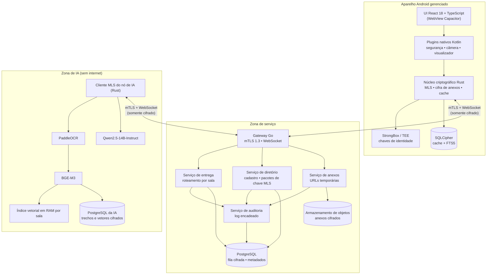
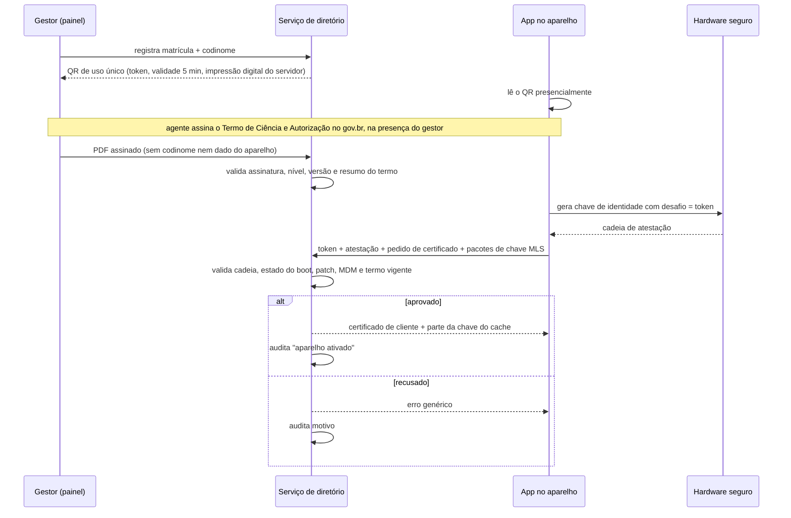
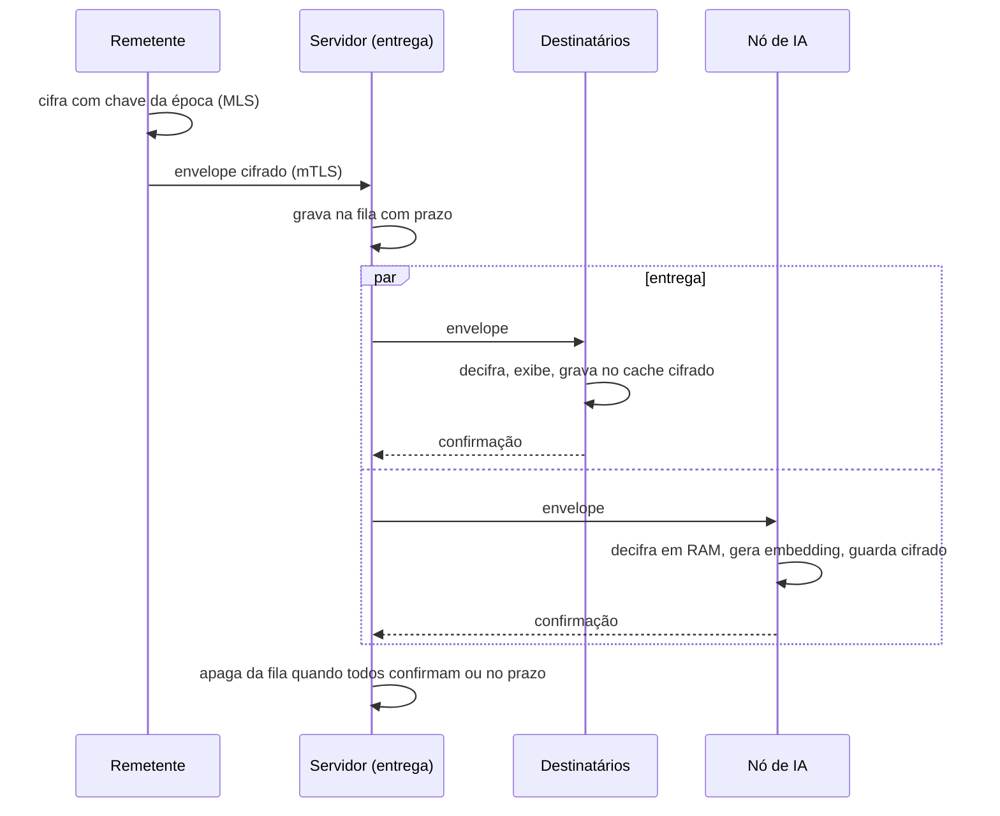
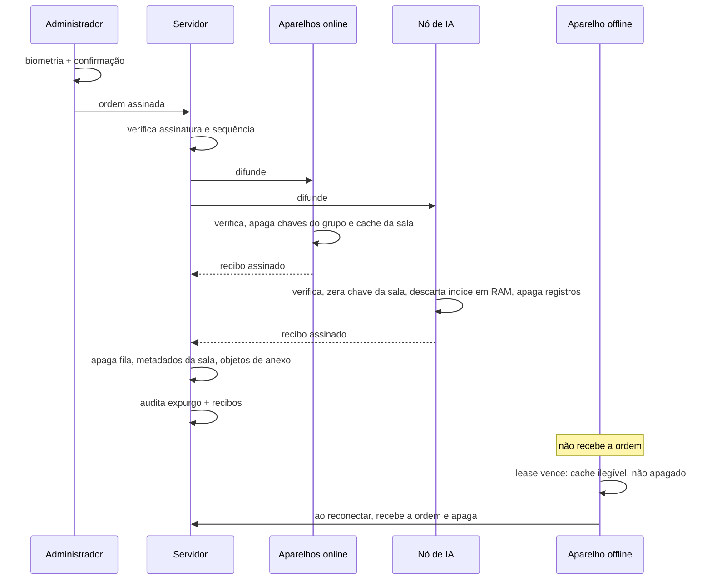

# 02 — Arquitetura e Engenharia

**Projeto:** MIGDOL
**Versão do documento:** 0.2 — rascunho para validação
**Público:** equipe de desenvolvimento e revisores de segurança

> Este documento substitui os trechos de código dos rascunhos anteriores. A seção 12 lista o que foi corrigido e por quê. Versões de bibliotecas devem ser confirmadas na Fase 0; nada aqui foi compilado ou testado ainda.

---

## 1. Princípios

1. **O servidor de mensagens é tratado como hostil.** Só vê texto cifrado e metadados mínimos.
2. **Fora dos aparelhos, só há texto em claro em dois lugares:** o **nó de IA**, apenas em memória, como membro declarado da sala; e a **estação isolada** de abertura de custódia, só durante cerimônia de quórum presencial (ADR-0003 seção 6; D12). A análise da investigação sigilosa roda nessa mesma classe de estação isolada de cerimônia, e não num terceiro lugar (ADR-0010 seção 6; proposta, a decidir depois do spike de inferência: máquina de análise separada da que fala com o HSM, com os mesmos requisitos, 01g-G10a).
3. **Apagar é destruir chave.** Exclusão de registros é complemento.
4. **Criptografia não é escrita à mão.** Protocolo e primitivas vêm de bibliotecas auditadas; nosso código faz orquestração.
5. **Segredos ficam no core e no hardware.** A interface (React no código de hoje; Compose e SwiftUI a partir da Fase 1, pela ADR-0007 aceita) nunca toca em chave privada; Kotlin e Swift só seguram referência de chave de hardware (regra 2).
6. **Toda defesa no aparelho é contornável por quem controla o aparelho.** Por isso há atestação no servidor, marca d'água e prazos de validade.

---

## 2. Visão geral



O nó de IA conecta-se ao gateway como qualquer cliente. Não há caminho de rede direto entre o serviço de entrega e os modelos.

**ADR-0007 (aceita, GD-19):** no aparelho, a UI React/Capacitor dá lugar a telas nativas (Compose no Android; SwiftUI no iPhone, depois do estudo de viabilidade), sobre o mesmo núcleo Rust. Este diagrama e as seções 3, 7.2 e 8 ainda descrevem a pilha anterior; o texto muda com o código, na Fase 1, quando `app/` vira `android/`.

---

## 3. Pilha tecnológica

| Camada | Escolha | Observação |
|---|---|---|
| Interface | React 18, TypeScript, Tailwind, Vite | Estado com Zustand; lista virtualizada para a conversa. **ADR-0007 (aceita):** Jetpack Compose (Android) e SwiftUI (iPhone, depois do estudo), a partir da Fase 1 |
| Casca nativa | Capacitor (versão estável corrente) | Somente Android na v1. **ADR-0007 (aceita):** sai, junto com a WebView, na Fase 1 |
| Plugins nativos | Kotlin | Segurança do aparelho, câmera interna, visualizador de anexos, ponte para o núcleo |
| Núcleo criptográfico | Rust, exposto por JNI (UniFFI) | OpenMLS como candidata; confirmar no spike. Com a ADR-0007, também gerado para Swift pelo UniFFI |
| Cache local | SQLCipher com FTS5 | Busca textual local |
| Backend | Go | `net/http`, biblioteca WebSocket mantida, `pgx/v5` |
| Banco do backend | PostgreSQL | Sem conteúdo em claro |
| Anexos | Armazenamento compatível com S3, on-premises | MinIO, SeaweedFS ou Garage — verificar situação de licença e manutenção de cada um antes de escolher |
| OCR | PaddleOCR (modelo para português) | Tesseract como reserva |
| Embeddings | `BAAI/bge-m3`, 1024 dimensões | Multilíngue; não usa prefixo de instrução |
| LLM | `Qwen/Qwen2.5-14B-Instruct` | Ver dimensionamento na seção 9 |
| Servidor de inferência | vLLM (pesos AWQ) **ou** llama.cpp (GGUF) | Um ou outro; os formatos não se misturam |
| Gestão de aparelhos | Android Enterprise via MDM da instituição | Distribuição privada do app |

---

## 4. Identidade e cadastro

### 4.1 Chaves por aparelho

| Chave | Algoritmo | Onde fica | Uso |
|---|---|---|---|
| Identidade do aparelho | EC P-256 em StrongBox/TEE | Hardware, não exportável | Atestação e certificado mTLS |
| Assinatura MLS | Ed25519 | Núcleo Rust, embrulhada por chave do Keystore | Credencial no grupo |
| Assinatura de administrador | Ed25519 | Idem, uso condicionado a biometria | Ordens de expurgo e autorizações de exportação |
| Chave do cache local | 256 bits | Aleatória, gerada no core e gravada embrulhada pela chave do lease (ver 4.3; ADR-0006) | SQLCipher |

A chave de identidade usa P-256 porque é o que o hardware seguro do Android suporta de forma ampla com atestação. As chaves Ed25519 ficam fora do hardware, mas embrulhadas por uma chave AES que só existe nele.

A "assinatura de administrador" cobre também os papéis da sala e da revinculação: comandante, subcomandante e solicitante, ou o superior imediato dele (conclusão, RN18), equipe de inteligência (marcar ativa), segunda assinatura da sala comum com a flag ligada (RN17, GD-14) e aprovadores da revinculação (RN19). As chaves públicas desses papéis vão no estado autenticado do grupo ou numa lista assinada em cerimônia; o core as confere, e nunca as aprende pelo diretório (ADR-0005, D19).

**Escopo da regra 2 (aplicado ao `CLAUDE.md` pela GD-12):** chaves privadas e de sessão de membro (MLS, assinatura, cache) só no core Rust. A chave de identidade P-256 e a chave AES de embrulho ficam no hardware (StrongBox/TEE; Secure Enclave no iPhone, ADR-0007), e Kotlin ou Swift só seguram a **referência** (alias); o uso é chamado a partir do core. O que o hardware devolve (ex.: desembrulho pelo Keystore) passa pela JVM só no quadro da chamada iniciada pelo core, é zerado em seguida e sozinho não abre nada. **Na JVM, zerar é melhor esforço** (cópias do coletor e do JNI): o spike verifica a saída do Keystore num buffer direto alocado pelo core, fora do heap **[verificar no spike]**, e o limite consta da seção 6.3 (01e-E15). O spike MLS (etapa 3) prova o caminho da chamada em emulador; a etapa 5, em hardware real (depois de G1). Chaves da instituição (AC, quórum, cerimônia) ficam em HSM, fora do app. Se o `ai-node/client` reutilizar o core, a regra vale para ele também (decidir no spike).

### 4.2 Fluxo de cadastro



O servidor de diretório conhece o vínculo usuário ↔ aparelho, mas **não guarda a matrícula em claro** (D09): guarda o codinome, a matrícula cifrada para a chave de quórum de pseudonimato e um índice de consulta calculado com chave fora do `server/` (seção 7.5). As salas só conhecem o codinome.

**Limite do D09 (01c-C15):** matrícula é enumerável. Quem tiver a chave do índice e leitura do banco refaz a tabela matrícula ↔ codinome inteira. Por isso a chave do índice fica em **HSM, não exportável**, com consulta registrada e limitada por taxa, nunca em token do gestor (opção mais restritiva; custo para o gestor: pergunta 12 do 01c). O quórum protege o vínculo **em repouso e em massa**; não protege o que o gestor sabe por função ao fazer o cadastro (R40).

**Atestação conferida fora do diretório (D20):** a estação do gestor também verifica a cadeia de atestação e confere com o aparelho um código curto antes de ativar. Diretório comprometido sozinho não ativa aparelho fantasma. Transparência de chaves antes do piloto (doc 07 seção 9).

### 4.3 Chave do cache local e validade (lease)

Desenho revisto pela ADR-0006 (proposta, D21), que substitui a ADR-05 se aceita:

```
chave_banco = aleatória, gerada no core (chave do SQLCipher)
kek_n       = HKDF( segredo_hardware , segredo_servidor_n , "cache-lease-v2" )
gravado     = embrulho AEAD de chave_banco com kek_n
```

- `segredo_hardware`: liberado pelo Keystore após biometria/PIN.
- `segredo_servidor_n`: entregue a cada sessão autenticada, mantido só em memória e **trocado a cada renovação** (padrão 12 h). O core reembrulha a chave do banco com o segredo novo; o servidor guarda **só o vigente**.

Consequências:
- Aparelho offline além do prazo não abre o cache: o segredo saiu da memória (relógio monotônico) e o servidor só o entrega de novo após sessão autenticada e atestação. Aparelho **revogado** não abre mais pelo servidor: em **toda** revogação o servidor sela o segredo vigente para a chave de quórum do segredo de lease e apaga a cópia em claro, mesmo que a ordem de expurgo nunca chegue. **Revogar não destrói:** destruir o segredo selado é ato separado, com duas autorizações (GD-13; ADR-0006 item 8). Segredo capturado antes de uma renovação não abre o cache depois dela.
- Renovação com número de geração, `n` e `n+1` guardados até a confirmação e gravação atômica; segredos de lease com RPO 0 **[proposta]** (ADR-0006 itens 3 e 10; 01c-C12). Limites declarados na ADR-0006 (01c-C13).
- **Lease vencido não apaga o cache: só o deixa ilegível** (D23). Apagar é ato separado: ordem assinada ou nível 4 da escada (doc 07 seção 7.1). Saiu daqui o texto anterior "o app também apaga o cache ao detectar validade vencida".
- O Android pode encerrar o processo e levar o segredo da memória; em campo, o cache fica ilegível até novo contato. Decidir no protótipo de D-R1 (serviço em primeiro plano) (D26).

---

## 5. Protocolo de mensagens

### 5.1 Por que MLS

Em canais com dezenas de membros, cifrar par a par (Double Ratchet) custa uma operação por destinatário e torna a remoção de membro cara. O MLS mantém uma chave de grupo em árvore, com custo logarítmico, sigilo futuro e troca de chaves a cada mudança de membros.

### 5.2 Mapeamento

| Conceito do produto | No protocolo |
|---|---|
| Operação | Um grupo MLS |
| Canal | Rótulo dentro do conteúdo cifrado (v1). Canais com membros diferentes viram grupos separados (v2) |
| Entrar / sair | Commit de inclusão / remoção; nova época de chaves |
| Nó de IA | Membro comum, com credencial marcada como "serviço" |
| Administrador | Papel verificado pelos clientes: só aceitam commits e ordens assinados por chave de administrador registrada no **estado autenticado do grupo** (extensão do contexto) na criação, ou por commit de administrador vigente; nunca aprendida pelo diretório (ADR-0005, D19) |
| Marca de custódia e papéis da sala | Extensão do contexto do grupo, assinada na criação; tipo comum, sob custódia ou sistema; com a flag ligada, "comum" exige motivo e segunda assinatura (GD-14); os clientes recusam commit que altere a marca (ADR-0003, RN17, RN18) |
| Chave pública de custódia do período | Extensão do contexto; período só por tempo, como hipótese do spike (ADR-0003 seção 2; 01c-C06, 01e-E21e); estrutura assinada com classe, lote, validade, identificador e suíte, e atribuição à sala assinada pelo administrador (01c-C05) |
| Mudança de membros | Um commit por época, com declaração de membros assinada que o diretório verifica antes de gravar (ADR-0005) |

### 5.3 Envelope

O servidor vê apenas:

```
room_id      : identificador aleatório de 128 bits (sem significado)
epoch        : época MLS
epoch_hash   : hash do transcript confirmado da época, nos dados autenticados do
               quadro MLS (em claro, coberto pela cifra); comparado antes de decifrar (ADR-0005)
sender_leaf  : cifrado pelo MLS (remetente oculto do servidor)
ciphertext   : mensagem MLS
custody_ct   : cópia de custódia (HPKE para a chave pública do período); em sala sob custódia,
               obrigatória em todo envelope de aplicação, de qualquer tipo (ADR-0003)
expires_at   : prazo de descarte na fila
```

Conteúdo cifrado (CBOR):

```
type         : text | attachment | ocr_result | ai_request | ai_response | export_grant
             | history_share | control
channel      : rótulo do canal
body         : conforme o tipo
sent_at      : hora do remetente
ttl          : autodestruição, se houver (não tira a cópia de custódia)
custody_hash : hash de custody_ct, conferido por quem recebe (sala sob custódia)
```

`history_share` é o pacote de histórico da revinculação, cifrado só para o aparelho novo (doc 07 seção 7.4). `control` inclui marcar ativa e concluir a sala (RN18). O campo `epoch_auth` (resumo do estado dentro do conteúdo) saiu: quem decifra já concorda no estado, e quem está noutro ramo não decifra (01c-C02); a comparação passou para `epoch_hash`, em claro.

### 5.4 Anexos

1. O app gera chave aleatória de 256 bits e cifra o arquivo com AES-256-GCM em blocos.
2. Pede ao serviço de anexos uma URL temporária de envio; o nome do objeto é um identificador aleatório.
3. Envia o arquivo cifrado.
4. Publica na sala uma mensagem `attachment` com: identificador do objeto, chave, hash e tipo.

O armazenamento nunca recebe a chave. Cifra no lado do servidor (SSE) pode ficar ligada como camada extra, mas não é a proteção principal. Em sala sob custódia, a chave do arquivo vai também na cópia de custódia da mensagem, e o objeto cifrado é retido pelo prazo de guarda (ADR-0003).

### 5.5 Ordem de commits e bifurcação

Um commit por época no servidor, chaves de administrador no estado do grupo e declaração de membros verificada pelo diretório: ADR-0005 (proposta, D16).

**Detecção de bifurcação sem decifrar (ADR-0005 item 2; 01c-C02):** toda mensagem leva época e hash do transcript confirmado nos dados autenticados em claro (`epoch_hash`). Sinais: mensagem da mesma época com hash diferente; mensagem da mesma época que não decifra; commit divergente de um já aplicado; época futura sem commit e par em época antiga depois de um prazo. Os sinais são **classificados** (01e-E02; 01g-G13): **bifurcação provada** (commit conflitante cuja assinatura de administrador registrado o cliente verifica, ou importação de cadeia) gera SEV1; mensagem que decifra com hash divergente é falha do remetente (SEV2); pacotes que não decifram ou trazem hash diferente, em qualquer quantidade, são **anomalia não autenticada** (alerta "servidor ou membro anômalo", sem recomendar recriar a sala, com limite de alertas por sala e época); duplicata e fora de janela não contam. O aparelho fica no próprio ramo, o administrador decide. Valor falso posto pelo servidor é anomalia, não bifurcação escondida. **Limite:** partição total e **commit retido** (o caso mais provável com servidor hostil) só se detectam na reunificação, na importação de cadeia (ADR-0004), na **confirmação de época** **[proposta]** e no código de segurança por sala e época (RF04) (01e-E03).

O spike MLS (etapa 3) prova esses pontos, com os dois casos: bifurcação induzida pelo servidor e partição total.

---

## 6. Fluxo criptográfico e de expurgo

### 6.1 Mensagem de texto



### 6.2 Ordem de expurgo

Formato assinado (binário, campos de tamanho fixo ou com prefixo de comprimento, sem JSON):

```
"MT-EXPUNGE-v1" | room_id (16) | seq (8) | issued_at (8) | reason (1) | admin_key_id (32)
assinatura Ed25519 (64) sobre todos os bytes acima
```

Regras:

- `seq` é um contador crescente por sala. Aparelhos e servidor rejeitam valor menor ou igual ao último visto. Isso substitui cache de nonces e sobrevive a reinício.
- **Único escritor do `seq` (D29):** o administrador titular da sala; em missão, o administrador da missão (ADR-0004). O substituto parte do último `seq` registrado no estado do grupo. O `seq` vigente vai no estado do grupo e chega a quem entra ou é revinculado.
- **Ordem de verificação no servidor:** tamanho → administrador conhecido para a sala → assinatura → janela de tempo → sequência. Nenhum estado é gravado antes de a assinatura passar.
- **Cada aparelho verifica a assinatura por conta própria**, contra a chave de administrador do estado autenticado do grupo. Um servidor comprometido não consegue forjar expurgo. O aparelho usa **só assinatura e contador**, sem janela de tempo, que é inviável offline (D29).
- Com dupla custódia ativa, a ordem leva duas assinaturas de administradores distintos.
- **Conclusão** (RN18): ordem no mesmo padrão binário, com o hash do número e do relatório e três assinaturas distintas (comandante, subcomandante, solicitante; ou o superior imediato do solicitante, quando este é comandante ou subcomandante). Signatário que não é membro assina sobre o identificador opaco da sala, sem ver conteúdo. Dispara o expurgo conforme o tipo da sala.

**Ordem de apagamento de aparelho** (doc 07 seção 7.4; D24, D29): formato próprio, com aparelho-alvo, e duas assinaturas.

```
"MT-WIPE-v1" | device_id (16) | seq (8) | issued_at (8) | reason (1) | key_id_1 (32) | key_id_2 (32)
duas assinaturas Ed25519 (64 + 64) sobre todos os bytes acima
```

O `seq` é por aparelho. As chaves de quem autoriza são registradas em cerimônia e conferidas no core.



### 6.3 O que é destruído e como

| Dado | Onde | Método |
|---|---|---|
| Chaves do grupo MLS | Aparelhos, nó de IA | Remoção do estado do grupo |
| Cache de mensagens | SQLCipher no aparelho | Exclusão das linhas da sala e do estado do grupo. O cache não tem chave por sala: a exclusão de uma sala é por linha (resíduo em páginas livres a tratar na Fase 4 **[verificar]**); a base inteira é ilegível sem o segredo de lease (ADR-0006) |
| Fila cifrada | PostgreSQL do backend | Exclusão; já era ilegível para o servidor |
| Anexos cifrados | Armazenamento de objetos | Exclusão; chaves só existiam nas mensagens |
| Trechos, OCR e vetores | PostgreSQL da IA | Chave da sala destruída + exclusão da partição |
| Índice vetorial | RAM do nó de IA | Descartado |
| Relatórios de IA | Cache do administrador | Como o cache |
| Cópia de custódia (só sala sob custódia) | Serviço `custody` e HSM offline | **Não** é destruída no expurgo nem na conclusão. Eliminação no fim do prazo, destruindo no HSM, e nos backups dele, as chaves privadas dos períodos, com recibo (ADR-0003 seção 7) |
| Segredo de lease guardado (aparelho revogado) | Serviço `custody` | **Não** é destruído na revogação. Eliminação no fim do prazo da apuração, com o período da classe; destruição antecipada só com duas autorizações (ADR-0006 item 8) |
| Trilha de auditoria | PostgreSQL do backend | **Permanece** (sem conteúdo) |

Limite conhecido: memória de processo em Go, Python, JavaScript e na JVM (Kotlin) não pode ser zerada com garantia, por causa do coletor de lixo e das cópias do JNI (01e-E15). Chaves sensíveis ficam no núcleo Rust, em memória travada e zerada de forma explícita. Para o restante, a proteção é não persistir e reiniciar o processo do nó de IA após o expurgo.

---

### 6.4 O que o sistema pode e não pode entregar a uma ordem externa

| Existe e pode ser entregue por rito | Não existe (por desenho) |
|---|---|
| Mensagens cifradas armazenadas e anexos cifrados | Conteúdo em claro de mensagens (regra 3) |
| Metadados que o servidor precisa para entregar (sala em forma opaca, horário, tamanho, estado dos aparelhos) conforme a seção 7.5 | Chaves privadas e de sessão (regra 2; só no core) |
| Registros de auditoria, aceites do termo, status e revogação de aparelhos | Cliente web, segundo aparelho ou vínculo de espelhamento |
| Registro de visualização, alertas, termo de revinculação, segredo de lease guardado e cópia de custódia, cifrados para a chave de quórum (ADR-0003); só abertos por quórum presencial de no mínimo 3 comandantes em HSM offline, com CI e base registrada. Cópia de custódia só existe em sala sob custódia | Interceptação em trânsito: tudo é mTLS 1.3 com MLS por cima |
| | Conteúdo de sala comum depois da conclusão: expurgado, sem cópia |

Observações:
- O nó de IA vê texto em claro na RAM como **membro declarado** da sala; é um ponto a incluir no parecer, pois uma ordem ao nó atingiria a instituição, não um terceiro.
- Material de evidência sai como **pacote assinado** (RF67), não como captura de tela.
- Apreensão de aparelho por autoridade: o padrão é suspender e revogar, sem expurgo remoto, até a decisão D-R14 (escada de resposta: doc 07 seção 7.1).
- **Arquivo institucional só em sala sob custódia** (ADR-0003 revisada; doc 07 seção 7.3): cópia HPKE para chave pública de quórum, aberta por quórum presencial com CI (sempre) e ordem judicial (cumprida) ou processo administrativo com validação jurídica **[conferir]**. Sala comum: o conteúdo é inacessível à instituição por desenho, **salvo** o cache de aparelho revogado em poder da instituição, pelo rito da regra 14, dentro do prazo do segredo guardado (ADR-0006 item 8; 01e-E20). Nem a investigação sigilosa grava sala comum (ADR-0010 seção 7).
- **Revinculação não usa o arquivo:** o histórico vem de outro membro pelo MLS (doc 07 seção 7.4). Um aparelho novo em MLS continua sem ler épocas anteriores.

## 7. Backend em Go

### 7.1 Serviços

| Serviço | Responsabilidade | Não faz |
|---|---|---|
| **Gateway** | Termina mTLS 1.3, valida certificado e situação do aparelho, mantém WebSocket, limita taxa | Não interpreta conteúdo |
| **Entrega** | Roteia envelopes por sala, mantém fila com prazo, coleta confirmações | Não conhece remetente nem conteúdo |
| **Diretório** | Cadastro, atestação, pacotes de chave MLS, membros por sala, leases | Não participa dos grupos |
| **Anexos** | Emite URLs temporárias, controla cota e expiração | Não tem chaves |
| **Auditoria** | Grava eventos em cadeia de hash; serve o perfil Auditor | Não recebe conteúdo |
| **Custódia** (planejado, D11) | Guarda cópias de custódia e registros cifrados para quórum (evidência, visualização, termo, posição guardada, segredo de lease guardado, registro de investigação sigilosa da ADR-0010); só apaga cifrados de período com recibo de eliminação; distribui o lote assinado de chaves públicas por classe e período; guarda as atribuições chave ↔ sala assinadas; registra pedidos de abertura e recibos de eliminação | Não tem chave privada; não decifra; não abre nada |

Na v1 rodam num único binário, mas cada serviço é um **módulo Go independente** (ADR-11): contrato público em `api/`, implementação em `internal/`, tabelas e migrações próprias. Os serviços só se falam por contrato, segundo um grafo fixo:

| Serviço | Pode depender de |
|---|---|
| audit | — |
| directory | audit |
| custody (planejado) | directory, audit |
| delivery | directory, audit, custody (planejado) |
| blobs | directory |
| gateway | directory, delivery |

`scripts/check-boundaries.sh` verifica o grafo. O serviço `custody` e as mudanças no grafo, no script e no `server/CLAUDE.md` entram com o código, na fase da custódia (doc 03 seção 5, Fase 4) (D11). **Selados de lease antes da Fase 4 (01e-E13) [proposta]:** na Fase 2, o `directory` sela com a chave pública da classe lida do pacote assinado e guarda o selado em tabela própria; na Fase 4, o `custody` os busca no `directory` pelo `api/` (sentido permitido) ou a tabela fica no `directory`. Não se cria `directory` → `custody` (ADR-0006 item 11). Separar em processos quando houver necessidade operacional, seguindo `docs/MIGRACAO-MICROSSERVICOS.md`.

### 7.2 Estrutura do repositório

```
MIGDOL/
├── CLAUDE.md                 # regras do projeto (+ um CLAUDE.md por componente)
├── docs/
│   ├── adr/                  # decisões novas (ADR-0001 em diante)
│   └── MIGRACAO-MICROSSERVICOS.md
├── scripts/
│   └── check-boundaries.sh   # verifica o grafo de dependências do server/
├── app/                      # React + Capacitor (ADR-0007 aceita: vira android/, com Compose, na Fase 1; apple/ depois)
│   ├── src/
│   └── android/
│       └── plugins/
│           ├── security/     # integridade do aparelho
│           ├── camera/
│           └── viewer/
├── core/                     # Rust: MLS, cifra de anexos, cache
├── server/                   # Go: monólito modular (go.work)
│   ├── cmd/server/           # composição: liga implementações aos contratos
│   ├── platform/ids/         # único código compartilhado (identificadores)
│   └── services/
│       ├── gateway/
│       ├── delivery/
│       ├── directory/
│       ├── blobs/
│       ├── custody/          # planejado (D11; ADR-0003)
│       └── audit/            # cada serviço: api/, internal/, migrations/, go.mod, CLAUDE.md
├── ai-node/                  # Python + cliente Rust
│   ├── client/
│   ├── ocr/
│   ├── embed/
│   ├── llm/
│   └── index/
├── admin-panel/              # painel do gestor
├── deploy/
└── tests/
    ├── integration/
    └── security/
```

### 7.3 Gateway: pontos obrigatórios

- `ClientAuth: RequireAndVerifyClientCert`, TLS 1.3 apenas, autoridade certificadora própria do projeto.
- Após o handshake: extrair o identificador do aparelho do certificado, conferir se está ativo e com lease válido.
- Verificação de `Origin` explícita (o rascunho anterior aceitava qualquer origem).
- Um escritor por conexão (goroutine dedicada com canal de saída limitado); cliente lento é desconectado, não trava os demais.
- Limites: tamanho máximo de envelope, mensagens por segundo por aparelho, conexões por aparelho.
- Logs sem corpo de mensagem e sem `room_id` em claro (usar hash com sal rotativo para correlação operacional).

### 7.4 Entrega: esqueleto

```go
// Estrutura ilustrativa — não é código final. No código real, `dir` é a interface
// directory/api.Directory e a fila pertence ao pacote delivery (ADR-11).
type Room struct {
    mu      sync.RWMutex
    members map[DeviceID]*Conn
}

type Hub struct {
    mu    sync.RWMutex
    rooms map[RoomID]*Room
    dir   Directory   // quem pertence a qual sala
    queue Queue       // fila cifrada com prazo
}

func (h *Hub) Publish(ctx context.Context, from DeviceID, env Envelope) error {
    if !h.dir.IsMember(ctx, env.RoomID, from) {
        return ErrForbidden            // autorização por sala em toda publicação
    }
    if err := h.queue.Put(ctx, env); err != nil {
        return err                     // grava antes de difundir
    }
    for _, c := range h.room(env.RoomID).snapshot() {
        c.TrySend(env)                 // não bloqueia; fila cobre quem perdeu
    }
    return nil
}
```

Diferenças em relação ao rascunho anterior: há salas, há autorização por sala, a difusão não trava em cliente lento e a entrega a quem está offline vem da fila.

### 7.5 Modelo de dados do backend

```sql
-- Sem conteúdo em claro em nenhuma tabela.
-- Cada serviço é dono das suas tabelas (migrations/ do serviço):
--   directory: users, devices, rooms, memberships, key_packages, terms, term_acceptances
--   delivery:  outbox, outbox_pending
--   blobs:     blobs
--   audit:     audit_log
--   custody:   custody_copies, period_keys, key_assignments, open_requests,
--              elimination_receipts, sealed_records (inclui segredos de lease guardados)
--              (planejado, D11; ADR-0003; ADR-0006)
-- Não há chave estrangeira entre serviços: room_id em outbox e blobs é uuid simples,
-- e o expurgo limpa por chamada ou evento, não por ON DELETE CASCADE (ADR-11).
-- Os trechos abaixo mantêm as REFERENCES entre tabelas do mesmo serviço apenas.
CREATE TABLE users (
    user_id      uuid PRIMARY KEY,
    -- Matrícula fora do claro (D09): cifrada (HPKE) para a chave de quórum de pseudonimato,
    -- e índice de consulta com chave em HSM, não exportável, consulta registrada (01c-C15; Fase 1).
    registration_sealed bytea NOT NULL,
    registration_index  bytea NOT NULL UNIQUE,
    codename     text NOT NULL UNIQUE,
    role         text NOT NULL,             -- gestor | operador | auditor; com a ADR-0009 (proposta)
                                            -- vira atribuições com prazo, motivo e duas pessoas
    created_at   timestamptz NOT NULL DEFAULT now(),
    revoked_at   timestamptz
);

CREATE TABLE devices (
    device_id     uuid PRIMARY KEY,
    user_id       uuid NOT NULL REFERENCES users,
    cert_fpr      bytea NOT NULL UNIQUE,
    attestation   jsonb NOT NULL,           -- resumo validado, sem segredos
    lease_until   timestamptz,
    status        text NOT NULL,            -- pending_term | active | suspended | revoked
    last_seen_at  timestamptz
);

CREATE TABLE rooms (
    room_id        uuid PRIMARY KEY,        -- aleatório, sem significado
    admin_keys     bytea[] NOT NULL,        -- chaves públicas Ed25519
    retention_secs integer NOT NULL,
    expunge_seq    bigint NOT NULL DEFAULT 0,
    dual_custody   boolean NOT NULL DEFAULT false,
    custody        boolean NOT NULL,        -- cópia da marca; a fonte é o estado do grupo (RN17)
    room_kind      text NOT NULL,           -- comum | sob_custodia | sistema (GD-14)
    lifecycle      text NOT NULL,           -- criada | ativa | concluida | expurgada (RN18)
    concluded_at   timestamptz,             -- início do prazo de guarda, em sala sob custódia
    expunged_at    timestamptz,             -- início do prazo se expurgada sem conclusão (01c-C10)
    created_at     timestamptz NOT NULL DEFAULT now()
);
-- O nome da operação NÃO fica aqui: vive dentro do estado cifrado do grupo.
-- admin_keys é cópia para o servidor verificar; os clientes usam o estado do grupo (ADR-0005).

-- memberships só muda a partir de declaração de membros assinada por administrador (ADR-0005).
CREATE TABLE memberships (
    room_id   uuid REFERENCES rooms ON DELETE CASCADE,
    device_id uuid REFERENCES devices,
    PRIMARY KEY (room_id, device_id)
);

CREATE TABLE key_packages (
    id         uuid PRIMARY KEY,
    device_id  uuid NOT NULL REFERENCES devices,
    package    bytea NOT NULL,
    claimed_at timestamptz
);

-- Termo de Ciência e Autorização (dono: directory). Ver docs/anexos e docs/06 seção 7.
CREATE TABLE terms (
    version      text PRIMARY KEY,
    text_sha256  bytea NOT NULL,
    published_at timestamptz NOT NULL,
    retired_at   timestamptz
);
CREATE TABLE term_acceptances (
    user_id       uuid NOT NULL REFERENCES users,
    version       text NOT NULL REFERENCES terms,
    signed_sha256 bytea NOT NULL,           -- hash do PDF assinado (o PDF fica em guarda segura)
    signer_level  text NOT NULL,            -- avançada | qualificada | presencial
    method        text NOT NULL,            -- govbr | icp | presencial
    witness_id    uuid,                     -- testemunha, na via presencial
    provisional_until timestamptz,          -- só via presencial; expira no servidor
    ratified_at   timestamptz,
    signed_at     timestamptz NOT NULL,
    validated_at  timestamptz NOT NULL,
    PRIMARY KEY (user_id, version)
);
-- Estado do aparelho: pending_term (aguardando termo) | active | suspended | revoked.

CREATE TABLE outbox (
    msg_id     uuid PRIMARY KEY,
    room_id    uuid NOT NULL,           -- sem FK: pertence ao diretório
    envelope   bytea NOT NULL,
    expires_at timestamptz NOT NULL
);
CREATE TABLE outbox_pending (
    msg_id    uuid REFERENCES outbox ON DELETE CASCADE,
    device_id uuid,
    PRIMARY KEY (msg_id, device_id)
);

CREATE TABLE blobs (
    object_key text PRIMARY KEY,            -- aleatório
    room_id    uuid NOT NULL,           -- sem FK: pertence ao diretório
    size_bytes bigint NOT NULL,
    expires_at timestamptz NOT NULL
);

CREATE TABLE audit_log (
    seq        bigserial PRIMARY KEY,
    at         timestamptz NOT NULL DEFAULT now(),
    actor      uuid,
    event      text NOT NULL,
    room_ref   bytea,                       -- hash do room_id
    detail     jsonb NOT NULL,
    prev_hash  bytea NOT NULL,
    this_hash  bytea NOT NULL
);
```

Configuração do PostgreSQL: `wal_level` padrão, replicação e backup normais. Como o banco não tem conteúdo legível, não há motivo para degradar a operação.

O papel de banco usado pela aplicação não tem `UPDATE` nem `DELETE` em `audit_log`. O último hash é publicado periodicamente em local externo (ex.: enviado ao Auditor) para que adulteração seja detectável.

---

## 8. Cliente

### 8.1 Divisão de responsabilidades

| Camada | Faz | Nunca faz |
|---|---|---|
| React (WebView) | Renderiza conversa, formulários, navegação | Tocar em chave, gravar em `localStorage`, abrir rede por conta própria |
| Plugins Kotlin | Integridade do aparelho, câmera, visualizador, biometria, ponte | Guardar conteúdo fora do núcleo; segurar chave de hardware além da referência (regra 2) |
| Núcleo Rust | MLS, cifra, cache SQLCipher, rede (WebSocket + mTLS) | Expor chave pela ponte |

A WebView recebe texto em claro apenas para exibir. Configuração: sem depuração remota em build de produção, sem acesso a arquivos, política de conteúdo restrita ao pacote do app, sem carregamento de origem externa.

**ADR-0007 (aceita, GD-19):** sem WebView, a interface é Compose (e SwiftUI depois), a partir da Fase 1. A mesma divisão vale: a interface nativa não grava dado fora do core (SharedPreferences, DataStore, arquivos, UserDefaults, Core Data) nem abre rede própria. A regra 4 do `CLAUDE.md` já tem esse texto (ADR-0007 item 5), e vale também para `app/src` enquanto existir.

### 8.2 Plugin de segurança do aparelho

Contrato exposto à interface:

```ts
interface DeviceSecurity {
  enableScreenProtection(): Promise<void>;
  getIntegrity(): Promise<IntegrityReport>;
  addListener(event: 'integrityChanged', cb: (r: IntegrityReport) => void): Handle;
}

interface IntegrityReport {
  secure: boolean;
  findings: Finding[];   // ex.: 'ADB', 'DEV_OPTIONS', 'ROOT', 'A11Y_UNKNOWN', 'PROJECTION', ...
}
```

Verificações (Kotlin), com a fonte de cada sinal:

| Sinal | Como obter | Ação |
|---|---|---|
| Captura e gravação bloqueadas | `FLAG_SECURE` em todas as janelas, inclusive diálogos e visualizador | Sempre ativo |
| Depuração USB / sem fio | `Settings.Global.ADB_ENABLED`, `adb_wifi_enabled` | Bloqueia |
| Opções de desenvolvedor | `Settings.Global.DEVELOPMENT_SETTINGS_ENABLED` | Bloqueia |
| App depurável ou depurador ligado | `ApplicationInfo.FLAG_DEBUGGABLE`, `Debug.isDebuggerConnected()` | Encerra |
| Root / bootloader | Atestação de chave (estado do boot verificado), **validada no servidor**. Play Integrity **não** é usado (docs/07 seção 8; ADR-0002 proposta) | Bloqueia cadastro e sessão |
| Instrumentação (Frida, Xposed) | Varredura de bibliotecas carregadas e portas conhecidas, feita no núcleo nativo | Encerra |
| Emulador | Propriedades de build + ausência de atestação de hardware | Bloqueia |
| Serviços de acessibilidade | `AccessibilityManager.getEnabledAccessibilityServiceList`, comparado a lista permitida | Bloqueia se fora da lista |
| Projeção / espelhamento | `DisplayManager.getDisplays()` (telas virtuais ou de apresentação); retorno de captura de tela (Android 14+) e de gravação (Android 15+) | Oculta conteúdo e audita |
| Sobreposição de tela | `setHideOverlayWindows(true)` (Android 12+) e filtro de toque obscurecido | Sempre ativo |
| Apps de acesso remoto | Consulta de pacotes contra lista (AnyDesk, TeamViewer, scrcpy-server etc.) | Bloqueia |
| Teclado de terceiros | `InputMethodManager`; exigir teclado permitido pelo MDM | Bloqueia |
| Área de transferência | Campos sem copiar/colar; limpeza ao sair | Sempre ativo |
| Notificações | Sem conteúdo; apenas "nova mensagem" | Sempre ativo |
| Backup | `allowBackup=false`, regras de extração de dados vazias | Sempre ativo |

As verificações rodam na abertura, ao voltar para primeiro plano e de forma periódica enquanto há conteúdo na tela. O resultado é enviado ao servidor; decisões de bloqueio de sessão são do servidor, não só do app.

O MDM complementa: impede instalação de apps fora da lista, desativa depuração, força versão mínima do sistema e permite apagar o perfil de trabalho remotamente. Em aparelho totalmente gerenciado, o desenho prevê apagar o aparelho inteiro por ordem assinada com duas autorizações (`MT-WIPE-v1`, seção 6.2; doc 07 seção 7.4). O MDM só apaga a partir dessa ordem, com duas pessoas no console (D24).

### 8.3 Marca d'água

- **Visível:** padrão repetido e semitransparente sobre a conversa e o visualizador, com codinome abreviado, 6 caracteres do identificador do aparelho e data/hora. Desenhado em camada nativa sobre a WebView, para não ser removível pelo DOM.
- **Invisível:** nas imagens exibidas e exportadas, pequena variação por aparelho resistente a recompressão. Técnica a definir e testar na Fase 2; a eficácia contra foto de tela precisa ser medida, não presumida.

### 8.4 Busca local

Tabela FTS5 dentro do SQLCipher, com tokenização para português e remoção de acentos. Indexa texto de mensagens e resultados de OCR. Segue a mesma retenção do cache.

---

## 9. Nó de IA

### 9.1 Papel

Processo único, em rede sem saída para a internet, que:

1. mantém um cliente MLS e participa das salas em que foi incluído;
2. decifra mensagens em memória;
3. executa OCR, embeddings, correção, interpretação e análise;
4. responde por mensagens cifradas na própria sala ou endereçadas a um único membro.

**Saídas de rede permitidas (proposta D31; não aplicada à regra 7 do `CLAUDE.md`, depende de autorização do responsável, antes da Fase 5):** o cliente MLS do nó abre conexão só para o gateway (mTLS), para o serviço de anexos da instância, para o PostgreSQL da IA e para o serviço de inferência local (vLLM ou llama.cpp, em `localhost` dentro do nó; seção 9.6) (01c-C19). Nada mais, verificado por teste em `tests/security` (E01).

### 9.2 Pedidos e respostas

| Função | Quem pede | Resposta visível para |
|---|---|---|
| OCR de foto | Automático | Todos da sala |
| Correção de texto | Qualquer membro | Só quem pediu |
| Interpretar mensagem | Qualquer membro | Só quem pediu |
| Busca semântica | Qualquer membro | Só quem pediu |
| Análise da operação | Administrador (pedido assinado) | Só o administrador |
| Análise entre operações (ADR-0008, proposta; depois da v1) | Analista, na sala de análise | Membros da sala de análise; saída estruturada com referência à origem, sem trecho de conversa; só salas do escopo de que o nó é membro **e que concederam** a entrada no escopo (GD-15), com filtro antes da busca |

Respostas individuais usam mensagem cifrada apenas para a chave do solicitante (HPKE), transportada pelo mesmo canal.

### 9.3 Pipeline de foto

```
anexo cifrado → baixa → decifra em RAM → remove EXIF (defesa em profundidade)
→ pré-processamento (cinza, redução de ruído, correção de inclinação)
→ PaddleOCR (pt) → filtro de confiança
→ texto → mensagem ocr_result para a sala
        → BGE-M3 → vetor → cifra com chave da sala → grava
```

Nada é escrito em disco em claro: contêiner com sistema de arquivos somente leitura, `tmpfs` para temporários, swap desativado.

### 9.4 Armazenamento vetorial

Decisão: **vetores e trechos cifrados em repouso; índice em memória por sala.**

```sql
CREATE TABLE room_keys (
    room_id     uuid PRIMARY KEY,
    wrapped_dek bytea NOT NULL,      -- chave da sala embrulhada pela chave mestra do nó
    kek_version integer NOT NULL
);

CREATE TABLE room_chunks (
    room_id    uuid NOT NULL,
    chunk_id   uuid NOT NULL,
    nonce      bytea NOT NULL,
    ciphertext bytea NOT NULL,       -- trecho + vetor, AES-256-GCM, AAD = room_id || chunk_id
    expires_at timestamptz NOT NULL,
    PRIMARY KEY (room_id, chunk_id)
) PARTITION BY LIST (room_id);
```

- Ao iniciar ou ao entrar numa sala, o nó decifra os vetores e monta o índice em RAM.
- Na escala de uma operação (milhares a dezenas de milhares de trechos), busca exata por produto interno em memória responde em milissegundos; índice aproximado só se o volume exigir.
- Expurgo: apaga a linha de `room_keys` (o conteúdo fica ilegível), remove a partição, descarta o índice.
- Uma chave por sala, não por linha. Rotação da chave mestra reembrulha apenas `wrapped_dek`.
- A chave mestra do nó fica em HSM ou TPM do servidor, quando disponível.

**Alternativa com pgvector** (índice HNSW no banco): mais simples de consultar, mas exige vetores em claro no banco. O expurgo deixaria de ser criptográfico para esses dados e dependeria de sobrescrita de disco. Só adotar se o volume por sala inviabilizar o índice em memória, e com volume cifrado dedicado. Se adotada: partição nomeada por UUID (não por texto derivado do nome), funções com `search_path` fixo e `plan_cache_mode = force_custom_plan`.

### 9.5 Modelo de linguagem

| Item | Valor | Observação |
|---|---|---|
| Modelo | Qwen2.5-14B-Instruct | |
| Precisão total (bf16) | cerca de 30 GB de VRAM só de pesos | Exige GPU de 48 GB |
| Quantizado 4 bits (AWQ no vLLM ou GGUF Q4_K_M no llama.cpp) | cerca de 10–12 GB de VRAM, mais contexto | Cabe em GPU de 24 GB junto com OCR e embeddings |
| Contexto | 16k–32k tokens para análise | 4096 é pouco para resumir uma operação |
| Saída estruturada | Decodificação guiada por esquema JSON | Evita falha de `json.loads` |
| Temperatura | 0,1 para análise; 0,3 para correção | |

Os números de memória são estimativas a confirmar com medição no hardware real.

Para operações longas, a análise usa resumo em etapas (blocos → resumos parciais → consolidação) e cita as mensagens de origem de cada afirmação, para que o administrador possa conferir.

Instrução de sistema para análise (base):

```text
Você apoia o responsável por uma operação policial de inteligência.
Analise somente o material fornecido. Não invente fatos, nomes ou locais.
Para cada afirmação, indique os identificadores das mensagens de origem.
Quando a informação for insuficiente ou contraditória, diga isso.
Produza: resumo executivo; linha do tempo; entidades citadas (pessoas por
codinome, locais, veículos); riscos à execução e à segurança da equipe;
pontos que exigem confirmação humana.
Responda no esquema JSON fornecido.
```

O material analisado é tratado como dado: o texto de mensagens e de OCR entra delimitado e a instrução determina que comandos contidos nele sejam ignorados. Isso reduz, mas não elimina, o risco de manipulação por documento fotografado (ver matriz de riscos).

### 9.6 Contêiner

Mantém-se do rascunho anterior: rede interna sem rota externa, raiz somente leitura, `tmpfs`, usuário sem privilégios, `no-new-privileges`, pesos montados como leitura, sem telemetria, sem log de requisições. Ajustes:

- Retirar `--trust-remote-code` (o Qwen2.5 não precisa).
- Fixar a imagem por digest, não por tag.
- `--max-model-len` conforme a tabela acima.
- O serviço de inferência escuta só em `localhost` dentro do nó; quem fala com o mundo é o cliente MLS.

---

## 10. Implantação

```
┌───────────────── Rede da instituição ─────────────────┐
│                                                        │
│  [Aparelhos via VPN/APN privada ou internet + mTLS]    │
│                 │                                      │
│        ┌────────▼────────┐                             │
│        │  Zona de serviço │  Gateway, Entrega,         │
│        │                  │  Diretório, Anexos,        │
│        │                  │  Auditoria, PostgreSQL,    │
│        │                  │  Armazenamento de objetos  │
│        └────────┬────────┘                             │
│                 │ somente porta do gateway             │
│        ┌────────▼────────┐                             │
│        │   Zona de IA     │  Nó de IA + GPU            │
│        │  (sem internet)  │  PostgreSQL da IA          │
│        └─────────────────┘                             │
│                                                        │
│  [Painel do gestor: rede interna, estação gerenciada]  │
└────────────────────────────────────────────────────────┘
```

- Discos cifrados em todos os servidores.
- Autoridade certificadora do projeto com chave raiz offline.
- Backups: apenas do banco do backend (sem conteúdo) e da configuração. O banco da IA **não** entra em backup, para que o expurgo seja definitivo.
- Monitoramento por métricas e eventos, sem conteúdo.
- **Instância dedicada por instituição** (D-R21, doc 09): nada é compartilhado entre instituições (servidores, banco, HSM, AC, MDM, chaves). Não há multi-tenant. O fornecedor entrega binário assinado e reproduzível e não acessa a produção.

### 10.1 Pacote de instalação offline (proposta, montado a partir da Fase 1)

Toda instalação (central, zona de IA, nó de campo) vem de **um pacote offline e assinado**, com manifestos YAML dentro. Só YAML não basta: a instalação não tem internet e precisa levar tudo.

```
migdol-<versão>/
  imagens/      servidor, nó de IA, PostgreSQL, armazenamento (OCI, fixadas por digest)
  manifestos/   YAML por perfil: central, zona-ia, campo
  config/       instituicao.exemplo.yaml (sem segredos)
  app/          APK assinado, distribuído pelo MDM
  sbom/         lista de componentes
  hashes/       hashes e assinatura do pacote; atestação de build reproduzível
  runbooks/     cerimônia da AC, do HSM e do quórum; instalação; atualização; retorno
  verificar     confere assinatura e hashes antes de qualquer passo
```

Regras:
- **Instala sem internet**; nada é baixado durante a instalação (regra 10, doc 09).
- **Verificar antes de instalar:** assinatura (chave de release em HSM, duas aprovações, doc 03) e hashes. Pacote que não confere não instala.
- **Um pacote para todas as instituições.** O que muda é o perfil e o `instituicao.yaml`: graus de sigilo, retenção, papéis, M e N do quórum, perfis de local, rito do termo, normas (RNF-T3). Também a **flag de custódia** e o motivo (`custodia.ativa`, `custodia.motivo`; ADR-0003): Exército ativa (investigação militar), polícia desligada por padrão (corregedoria ou inquérito, se ligada). O `instituicao.yaml` é **assinado**, visível aos membros, e mudar a flag exige cerimônia; não retroage. Com a flag ligada, a custódia é o padrão e sala comum exige motivo e segunda assinatura (GD-14). O pacote traz o **histórico assinado das versões** do `instituicao.yaml`, para conferir a marca de salas criadas antes de uma mudança (01c-C27). Papéis e combinações proibidas da ADR-0009 (proposta) também vêm daqui (D-R33).
- Chaves **públicas** de cerimônia (custódia, aprovadores) podem ir no pacote assinado: não são segredo.
- **Nenhum segredo em YAML nem no pacote.** Chaves nascem no HSM em cerimônia; senhas internas são geradas na instalação e guardadas cifradas.
- **Atualização** por pacote novo assinado, com migrações por serviço (ADR-0001) e caminho de retorno testado; o banco da IA continua fora de backup.
- O fornecedor entrega o pacote; a equipe da instituição instala; o fornecedor **não acessa** a produção (RNF-T2).
- **Orquestração (D-R28):** proposta **Docker Compose ou unidades systemd** (um binário, banco e armazenamento: superfície menor, auditoria mais simples). Kubernetes só se a instituição já o opera, com endurecimento próprio.

---

## 11. Decisões registradas (ADR resumido)

**Numeração (D34):** ADR-01 a ADR-15 são os resumos desta seção; os arquivos de `docs/adr` usam quatro dígitos e são outra série. ADR-03 (vetores) **não** é ADR-0003 (custódia); ADR-04 (expurgo) **não** é ADR-0004 (campo). Correspondência em `docs/adr/README.md`. Decisões novas usam só o número de arquivo.

| # | Decisão | Alternativa rejeitada | Consequência aceita |
|---|---|---|---|
| ADR-01 | MLS com biblioteca auditada em Rust | Double Ratchet par a par implementado no app | Ponte Rust↔Kotlin a manter |
| ADR-02 | Nó de IA como membro da sala | IA no backend com acesso oculto ao texto | Há um ponto com texto em claro; ele é declarado e isolado |
| ADR-03 | Vetores cifrados + índice em RAM | pgvector com HNSW em claro | Tempo de carga ao iniciar o nó; limite de volume por sala |
| ADR-04 | Expurgo por destruição de chave | `DROP TABLE` como mecanismo principal | Depende de gestão correta de chaves |
| ADR-05 | Lease de 12 h para o cache local (**a substituir pela ADR-0006**, proposta) | Confiar só na ordem de expurgo | App exige conexão periódica |
| ADR-06 | Android gerenciado apenas | Android + iOS desde o início | iOS fica para depois |
| ADR-07 | Sem autocompletar remoto | Sugestão de próxima palavra via nó de IA | Recurso adiado até haver modelo local |
| ADR-08 | Ordem de expurgo em binário com contador | JSON assinado + cache de nonces | Formato próprio a documentar e testar |
| ADR-09 | Auditoria de metadados encadeada | Nenhum registro | Existe prova de que a operação existiu |
| ADR-10 | Anexos cifrados no cliente | Cifra no servidor de objetos | Servidor não gera miniaturas |
| ADR-12 | Custódia só em sala sob custódia (flag por instituição; com a flag ligada, custódia é o padrão e sala comum exige motivo e segunda assinatura, GD-14): cópia HPKE para chave pública, privada só em HSM offline; abertura por quórum presencial de no mínimo 3 comandantes, com CI e base registrada; sem HSM online nem aprovação remota (docs/adr/0003, **proposta revisada na etapa 1b e na segunda rodada**) | Chave simétrica de custódia com os membros; HSM online com aprovação remota; chave do Auditor ou de um administrador sozinho; custódia em toda sala sem exceção | Acervo de até 5 anos das salas sob custódia exposto se o HSM ou o quórum caírem (admitido no GD-1; aceite formal do R68 pendente); serviço `custody`; estação isolada |
| ADR-13 | Instância dedicada por instituição, na infraestrutura dela (doc 09, **proposta**) | Multi-tenant em ambiente compartilhado | Uma instalação por instituição; operação conjunta numa só instância |
| ADR-14 | Nó tático de campo que só ordena (sem commit nem chave de membros); central congelada durante a missão; lease de campo com segredos de missão e teto de 72 h, sobre rádio IP; nó capturado destruído de imediato, como exceção escrita à GD-13 (GD-18) (docs/adr/0004, **proposta revisada na etapa 1b e na terceira rodada**, Fase 8) | Nó como committer; central prevalece; lease longo sem nó; malha sem dono | Novo componente a endurecer; importação de cadeia no retorno; central não entrega aos grupos de missão; destruição do nó perde o não sincronizado (R118) |
| ADR-0002 | Atestação sem Play Integrity (doc 07 seção 8, **proposta**; arquivo a criar antes do spike de atestação) | Play Integrity | Raízes de fabricante mantidas pela instituição |
| ADR-0005 | Um commit por época; detecção de bifurcação sem decifrar (hash do transcript nos dados autenticados em claro; mensagem da mesma época que diverge ou não decifra); pertença verificável pelo servidor (docs/adr/0005, **proposta**) | Commits livres; pertença só pelo diretório; resumo dentro do conteúdo cifrado | Commit pode falhar por corrida e ser refeito; partição total só se detecta na reunificação |
| ADR-0006 | Lease criptográfico: chave do banco reembrulhada a cada renovação, com geração; servidor guarda só o segredo vigente; lease vencido não apaga; revogar sela o segredo para quórum e não destrói (GD-13) (docs/adr/0006, **proposta**; contraria ADR-05) | Segredo fixo com validade lógica; apagar ao vencer; revogar apagando o segredo | Cache ilegível se o servidor ficar fora além do prazo; nova classe sob quórum |
| ADR-15 | Entrega por pacote offline assinado com manifestos YAML por perfil; orquestração Compose ou systemd (seção 10.1, **proposta**) | Instalação por internet; Kubernetes por padrão; segredos em YAML | Pacote grande; atualização manual por mídia controlada |
| ADR-0007 | Android na v1, iPhone só após estudo e ADR, macOS fora; telas nativas (Compose, SwiftUI); núcleo Rust único via UniFFI; monorepo; regra 4 nova (docs/adr/0007, **aceita**, GD-19) | Capacitor; três repositórios; macOS restrito; iOS na v1 | Interface feita duas vezes quando o iOS entrar; `app/` vira `android/` |
| ADR-0008 | Painel só com indicadores agregados de metadados (nível 1a); sem nível 1b (GD-15); agregados derivados e nominais só no app do analista, por MLS, de salas que concederam (GD-15), com regra de tipo, expurgo em cascata e saída estruturada; IA sem treino com dados (docs/adr/0008, **proposta**, redesenhada na terceira rodada) | IA no backend lendo texto; painel nominal; nível 2 sem ato da sala de origem; análise sem escopo; exceção à regra 3 | Ato a mais do administrador (conceder); nó de IA mais valioso |
| ADR-0009 | RBAC + ABAC com negação por padrão, atribuição dupla com prazo e combinações proibidas (docs/adr/0009, **proposta**) | Só RBAC; política livre; super administrador | Diretório guarda papéis com prazo |
| ADR-0010 | Investigação sigilosa de vazamento ou infiltrado: CI e segunda autorização independente; impedimento conferido pela estação isolada; registro selado com só o hash na trilha; quórum de detentores não impedidos em toda sessão (GD-21); nível 1 (metadados e registros selados, com CI validada, a base da regra 14) e nível 2 (conteúdo, com ordem judicial); segunda autorização de fora dos detentores quando a suspeita os alcança e no máximo duas renovações (GD-22); preservação selada com lista de bloqueio; análise só na estação; relatório de rastro sem conversas, revisado por duas pessoas; sem membro oculto nem uso do nó de IA (docs/adr/0010, **proposta**; GD-16, GD-17, GD-21 a GD-23) | Membro oculto; nó de IA como leitor; uma só autorização; consulta ao servidor vivo; pessoa lê conteúdo para confirmar | Cerimônias presenciais; estação com inferência depois da Fase 6; exceção ao registro legível da ADR-0003 seção 5 |
| ADR-11 | Monólito modular: um módulo Go por serviço, contratos em `api/`, dados e migrações próprios, sem FK entre serviços (docs/adr/0001) | Pacotes num só módulo; microsserviços desde já | Cerimônia de contratos; limpeza de expurgo explícita; separação futura sem reescrita |

---

## 12. Correções em relação aos rascunhos anteriores

| Rascunho | Problema | Correção |
|---|---|---|
| Hub WebSocket em Go | Difundia toda mensagem a todos os conectados; aceitava qualquer origem | Salas, autorização por publicação, verificação de origem (7.3, 7.4) |
| Verificador do kill-switch | Gravava o nonce antes de validar a assinatura; dependia de JSON idêntico em Go e TypeScript; estado só em memória | Assinatura primeiro; formato binário; contador persistido (6.2) |
| Kill-switch | Aparelhos confiavam no servidor | Cada aparelho verifica a assinatura do administrador |
| Kill-switch | Não tratava aparelho offline | Lease (4.3) |
| Plugin Android | Só `ADB_ENABLED` e modo desenvolvedor | Lista completa + atestação no servidor (8.2) |
| Expurgo por `DROP TABLE` | Não apaga blocos, WAL, réplicas nem backups | Destruição de chave como mecanismo principal (6.3, 9.4) |
| `wal_level = minimal` "para não alertar monitoramento" | Degrada a operação e contraria a auditabilidade | Removido |
| Partição nomeada pelo `room_id` higienizado | Nomes diferentes podiam colidir; nome revelava a operação | UUID aleatório |
| `ALTER TABLE ... NOT NULL` sem padrão | Falha em tabela com dados | Esquema novo desde o início |
| Chave por linha (DEK por tupla) | Custo sem ganho | Uma chave por sala |
| Qwen 14B "10–12 GB em bf16" | Subestimado; formato GGUF citado junto com vLLM | Tabela da seção 9.5 |
| `bge-large-en` como opção para português | Modelo só de inglês | Apenas BGE-M3, sem prefixo |
| "Zero-fill" em Python e Go | Não é garantido com coletor de lixo | Chaves no núcleo Rust; reinício do nó após expurgo |
| MinIO com SSE-KMS como proteção | Chave fica no servidor | Cifra no cliente (5.4) |
| PWA | Não atende aos requisitos de aparelho | App nativo |
| Esquema único do backend (7.5) com FK entre tabelas de serviços diferentes | Impede separar bancos | Tabelas por serviço, sem FK entre serviços (ADR-11) |
