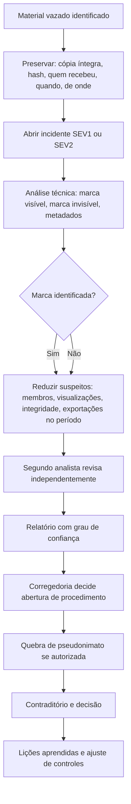

# 05 — Vazamentos, Detecção, Resposta a Incidentes e Atribuição

**Projeto:** MIGDOL
**Versão do documento:** 0.1 — rascunho para validação
**Público:** área de segurança, corregedoria, jurídico, equipe de operação, equipe de desenvolvimento

> O sistema reduz a chance de vazamento e aumenta a chance de descobrir a origem. Ele **não** prova culpa. Este documento define como usar a informação que o sistema produz sem acusar a pessoa errada e sem desrespeitar o devido processo. Aspectos jurídicos e de dados pessoais: documento 06.

---

## 1. Princípios

1. **Indício não é prova.** A marca d'água aponta um aparelho e um horário. Quem estava com o aparelho é uma segunda pergunta.
2. **Proporcionalidade.** Cada mecanismo de monitoramento tem finalidade escrita, é conhecido dos usuários e coleta o mínimo.
3. **Nenhuma consequência sem apuração humana.** Alerta do sistema abre investigação; não pune nem bloqueia pessoa.
4. **Contraditório.** Quem for apontado pode se manifestar antes de qualquer decisão.
5. **Quem investiga não é quem opera.** O administrador da operação não conduz a apuração de vazamento da própria operação.
6. **Tudo é registrado**, inclusive as consultas feitas pelos investigadores.

---

## 2. Camadas de defesa contra vazamento

| Camada | Objetivo | Mecanismos (onde estão) |
|---|---|---|
| **Prevenir** | Dificultar a saída de conteúdo | `FLAG_SECURE`, bloqueio de depuração e espelhamento, copiar/colar bloqueado, anexos sem salvar, notificações sem conteúdo (doc 02 seção 8; doc 03 seção 2) |
| **Reduzir** | Diminuir quem pode vazar e o que pode ser vazado | Compartimentação por canal, retenção curta, exportação autorizada (doc 04 seção 6.1) |
| **Dissuadir** | Fazer o usuário saber que será identificado | Marca d'água visível, aviso permanente, norma de uso assinada, treinamento |
| **Detectar** | Perceber tentativa ou vazamento | Eventos de integridade, monitoramento da seção 4, recebimento de material vazado |
| **Atribuir** | Reduzir o conjunto de suspeitos | Marca visível e invisível, trilha de leitura, variação por destinatário (seção 3) |
| **Responder** | Conter, apurar e corrigir | Seção 5 |

Limite declarado: foto da tela por outro aparelho e memorização não são impedidas (doc 03 seção 1.3). O esforço de atribuição existe justamente por isso.

---

## 3. Atribuição: como chegar à origem de um vazamento

### 3.1 Fontes de evidência disponíveis

| Fonte | O que mostra | Força |
|---|---|---|
| Marca d'água visível na foto | Codinome abreviado, 6 caracteres do aparelho, data e hora de exibição | Alta se legível; **removível** por corte ou edição |
| Marca invisível em imagem | Identificador do aparelho que exibiu ou exportou | Média; depende de recompressão e ângulo (testes F01–F03) |
| Trilha de exportação | Quem pediu, quem autorizou, qual arquivo, quando | Alta |
| **Registro de visualização** (a definir, seção 3.3) | Quais aparelhos tiveram aquela mensagem ou anexo aberto e quando | Média: reduz o conjunto de suspeitos, não prova autoria |
| Eventos de integridade | Aparelho com depuração, espelhamento ou acessibilidade suspeita no período | Indício |
| Variação por destinatário (opcional, seção 3.2) | Qual versão do texto foi entregue a qual aparelho | Alta para texto copiado literalmente |
| Lista de membros da sala/canal no horário | Universo de pessoas com acesso | Contexto |

### 3.2 Técnicas adicionais (decisão D-R3 do documento 04)

Nota: a instituição assume a responsabilidade pela privacidade (doc 06 seção 0). As ressalvas abaixo são de **integridade do conteúdo e validade da prova**, não de privacidade.

| Técnica | Como funciona | Vantagem | Custo e risco |
|---|---|---|---|
| **Variação de texto por destinatário** | Mensagens marcadas como sensíveis pelo administrador chegam com pequenas diferenças invisíveis ou quase (pontuação, espaços, ordem de itens equivalentes), distintas por aparelho | Identifica quem vazou **texto copiado** | Altera o conteúdo entregue; pode introduzir ambiguidade; **proibido** em ordem, endereço, valor ou dado em que a exatidão importe; o usuário deve ser informado de que o recurso existe |
| **Documentos e imagens marcados por destinatário** | Cada cópia visualizada leva marca invisível própria | Atribuição de arquivo | Já previsto (RF22) |
| **Compartimentação** | Informação crítica só em canal com poucos membros | Reduz drasticamente o conjunto de suspeitos | Custa fluidez; exige disciplina do administrador |
| **Janela de leitura** | Conteúdo sensível some após leitura ou prazo curto | Reduz tempo de exposição | Pode atrapalhar a operação |
| **Informação-isca (canary)** | Detalhe distinto entregue a subgrupos para ver qual aparece fora | Reduz suspeitos sem alterar o essencial | Exige decisão do administrador, planejamento e **parecer jurídico** antes de qualquer uso; não automatizar |

Recomendação para a v1: **marca visível + invisível, registro de visualização, compartimentação e janelas de leitura**. Variação textual e informação-isca ficam para decisão do comitê, após parecer jurídico.

### 3.3 Registro de visualização (adotado)

O aparelho registra localmente que exibiu a mensagem ou anexo `X` e envia ao servidor, **cifrado para o Auditor** (não para o administrador da operação), um recibo `(id da mensagem, aparelho, hora)`. O servidor não lê o recibo. Uso restrito ao rito da seção 3.4.

Pontos de projeto:
- Aumenta a capacidade de atribuição; é adotado pela decisão da instituição (doc 06 seção 0).
- É um dado de alto valor para o adversário (revela quem leu o quê): fica cifrado para o Auditor e fora do alcance do administrador de infraestrutura.
- Consta no RIPD e na transparência aos usuários, para proteger a validade da apuração.
- Retenção: igual à da operação mais o prazo de apuração.

### 3.4 Quebra de pseudonimato (decisão D-R2)

As salas só conhecem o codinome; o diretório conhece a matrícula. Ligar um aparelho a uma pessoa é o ato mais sensível da apuração. Proposta:

1. Pedido formal da corregedoria, com número de procedimento, finalidade e escopo (quais aparelhos, qual período).
2. Autorização do responsável pela homologação.
3. Execução com **duas pessoas distintas**: uma do papel Auditor e uma do papel Gestor. O sistema exige as duas assinaturas.
4. O resultado vai para o procedimento, não para quem pediu a análise de IA nem para o administrador da operação.
5. Todo o ato é registrado na trilha de auditoria, com o escopo consultado.

### 3.5 Procedimento ao receber material vazado

### 3.6 Grau de confiança do relatório

| Grau | Critério mínimo |
|---|---|
| **Alto** | Marca visível legível **e** marca invisível concordante **e** registro de visualização compatível **e** nenhum indício de aparelho emprestado ou comprometido |
| **Médio** | Apenas um dos elementos acima, ou elementos concordantes mas parciais |
| **Baixo** | Marca ilegível, removida ou contraditória; só contexto (lista de membros) |

Regras:
- Grau **Baixo** nunca fundamenta ação contra pessoa; serve para redirecionar a investigação e ajustar controles.
- Grau **Alto** é **indício forte**, ainda sujeito ao contraditório. Aparelho emprestado, esquecido, usado sob coação ou fotografado por terceiro são hipóteses que a apuração precisa afastar.
- O relatório declara taxas de erro conhecidas (resultados de F01–F03) e as limitações do método.

### 3.6a Base normativa e validade da prova

- Vazamento por servidor pode configurar **violação de sigilo funcional** (Código Penal, art. 325, verificado), inclusive acesso indevido a sistemas (§ 1º) e, havendo dano, pena maior (§ 2º). O relatório de atribuição serve de indício para esse procedimento, não de condenação.
- Em procedimento disciplinar, a prova precisa respeitar **contraditório e ampla defesa**; a jurisprudência do STJ admite prova emprestada com autorização e contraditório (Súmula 591, a conferir) e há decisões que anulam penalidade baseada em prova ilícita.
- A norma de uso e o termo assinado devem **prever expressamente** a coleta de alertas, marcas e registros usados, para que o uso não seja tratado como prova obtida por meio ilícito.
- Toda prova que sair do sistema leva **cadeia de custódia** (hash, quem acessou, quando). Regras do Código de Processo Penal sobre cadeia de custódia: **conferir**.
- Sobre acesso a dados de aparelho nas mãos de um investigado: observar o Tema 977 do STF (consentimento expresso ou ordem judicial).
- Resumo e fontes: docs/anexos/validacao-juridica-preliminar.md.

### 3.7 Limites da atribuição

- A marca visível pode ser cortada da foto. A invisível pode ser degradada por ruído, recompressão forte ou captura em baixa resolução.
- Quem fotografa a tela de **outra pessoa** ou de aparelho esquecido gera marca de terceiro. É o risco R36.
- Transcrição manual e memorização não deixam rastro técnico.
- Atribuição depende de a unidade **usar** o procedimento. Sem corregedoria ativa, a dissuasão enfraquece.

---

## 4. Detecção de ataques e de uso suspeito

Eventos **sem conteúdo** enviados a um sistema de monitoramento (SIEM ou equivalente da instituição). Limiares são ponto de partida.

| Evento | Sinal | Alerta |
|---|---|---|
| Atestação recusada em cadastro | Aparelho com root, emulador ou app reempacotado | Alerta ao gestor; 3 recusas do mesmo candidato → incidente |
| Integridade alterada | Depuração, espelhamento, acessibilidade não permitida, instrumentação | Alerta ao responsável pelo aparelho e à segurança; repetição em 7 dias → apuração |
| Certificado revogado ou lease vencido usado | Tentativa de conexão | Registro; repetição → possível aparelho perdido |
| Falha de verificação de assinatura | Ordem de expurgo, inclusão de membro ou autorização forjada | **Incidente SEV1** imediato: indica servidor ou rede comprometidos |
| Cadastro fora do padrão | Muitos cadastros por gestor, fora do expediente, mesmo local | Alerta ao Auditor |
| Pico de exportações | Usuário ou operação acima do habitual | Alerta ao administrador e ao Auditor |
| Pedidos de análise de IA fora do padrão | Volume ou horário anormal | Alerta ao Auditor (R42) |
| Tentativas de acesso a sala sem associação | Publicar ou ler sala alheia | Alerta de segurança |
| Falha repetida de biometria ou PIN | Tentativas de desbloqueio | Bloqueio local progressivo; ao 5º erro, sessão encerrada e evento |
| Inundação de conexões ou mensagens | Limites de taxa acionados | Alerta de disponibilidade |
| Integridade da cadeia de auditoria | Hash publicado ≠ calculado | **Incidente SEV1** |
| Acesso administrativo à infraestrutura | Sessão privilegiada aberta | Registro e revisão semanal pelo Auditor |
| Nó de IA: tentativa de conexão de saída | Bloqueio de rede acionado | **Incidente SEV1** |

Armadilhas de alerta: evitar excesso de falsos positivos (revisão mensal dos limiares) e **nunca** colocar conteúdo, `room_id` em claro ou nome real em alerta.

---

## 5. Resposta a incidentes

### 5.1 Severidade

| Nível | Critério | Resposta | Exemplos |
|---|---|---|---|
| **SEV1** | Possível exposição de conteúdo, comprometimento de chave, ou servidor/IA/CA comprometidos | Imediata; comitê acionado; operação pode ser suspensa | Assinatura forjada, material vazado, chave de administrador exposta |
| **SEV2** | Risco alto, sem confirmação de exposição | Até 4 h | Aparelho apreendido com sessão ativa, ataque persistente de cadastro |
| **SEV3** | Falha de controle sem exposição | Até 2 dias úteis | Aparelho com integridade alterada, vulnerabilidade alta |
| **SEV4** | Anomalia | Próximo ciclo | Pico isolado de erro |

### 5.2 Papéis

| Papel | Função |
|---|---|
| Comandante do incidente | Decide, coordena, mantém o registro |
| Líder técnico | Contenção e investigação técnica |
| Jurídico / corregedoria | Preservação de provas, procedimento, comunicação formal |
| Encarregado de dados | Avalia impacto a dados pessoais e comunicação (documento 06) |
| Comunicação interna | Informa usuários e chefias, sem detalhar o que não deve |
| Escriba | Linha do tempo e decisões |

### 5.3 Fases

1. **Preparação:** papéis, contatos, playbooks, acesso de emergência testado.
2. **Detecção e triagem:** classificar severidade; abrir registro.
3. **Contenção:** limitar o dano sem destruir evidência (isolar, revogar, suspender; **não** reiniciar nem apagar antes de preservar, exceto expurgo quando a proteção do conteúdo prevalecer e a decisão estiver registrada).
4. **Erradicação:** remover a causa (corrigir, rotacionar chaves, substituir aparelho).
5. **Recuperação:** voltar a operar com monitoramento reforçado.
6. **Lições aprendidas:** em até 10 dias úteis; atualiza controles, registro de riscos e documentos.

### 5.4 Playbooks

Para cada um: **0–1 h** contenção, **1–24 h** apuração, **depois** correção e registro.

| # | Cenário | 0–1 h | 1–24 h | Depois |
|---|---|---|---|---|
| P1 | **Material vazado** (foto, texto) | Preservar com hash; abrir SEV1; restringir quem pode ver as salas envolvidas se houver suspeita de continuidade | Análise de marca (3.5); reduzir suspeitos; avaliar expurgo ou renovação de chaves das salas | Relatório com grau de confiança; corregedoria; ajustar compartimentação |
| P2 | **Aparelho perdido, roubado ou apreendido** | Revogar certificado; suspender aparelho; avaliar expurgo remoto do perfil de trabalho; avisar administradores das operações dele | Remover o aparelho dos grupos (novas chaves de época); verificar se houve acesso após o evento | Substituir aparelho; registrar; avaliar coação |
| P3 | **Chave de administrador comprometida** | Revogar a chave; bloquear ordens com ela; avisar membros | Reemitir chave; revisar ordens e autorizações assinadas desde o possível comprometimento | Revisão do procedimento de guarda |
| P4 | **Servidor de mensagens comprometido** | Isolar; preservar imagens; **não** apagar logs; avisar comitê | Avaliar metadados expostos; verificar se clientes rejeitaram tentativas (assinaturas); reconstruir a partir de imagem confiável | Rotacionar credenciais e certificados; relatório; ajustar controles |
| P5 | **Nó de IA comprometido** | Desconectar da rede; reiniciar após preservar; remover o nó das salas | Listar salas afetadas (conteúdo em claro possivelmente exposto); decidir expurgo; renovar chaves | Reconstrução; revisão de isolamento |
| P6 | **Autoridade certificadora comprometida** | Revogar intermediária; convocar cerimônia da raiz | Reemitir certificados de todos os aparelhos; reautenticar | Revisão da cerimônia e da guarda |
| P7 | **Ataque de negação de serviço** | Aplicar limites e filtros; ativar contingência definida pela unidade | Identificar origem; reforçar capacidade | Revisar plano de continuidade |
| P8 | **Vulnerabilidade crítica em dependência** | Avaliar exploração; mitigar (desativar recurso, regra de rede) | Corrigir e distribuir release de emergência | Atualizar SBOM e registro de riscos |
| P9 | **Insider de infraestrutura** | Suspender acessos; preservar sessões gravadas | Revisar o que foi acessado; envolver corregedoria | Revisão de separação de funções |
| P10 | **Expurgo ou convite indevido** | Contenção conforme o caso; se expurgo, não há reversão: registrar | Comunicar impactados; reconstruir a operação se necessário | Reforçar confirmações e treinamento |

### 5.5 Comunicação
- **Interna:** quem precisa saber, no nível necessário. Não anunciar detalhes que ajudem o atacante.
- **Externa (ANPD, titulares, órgãos de controle):** decisão do jurídico e do encarregado; critérios e prazos no documento 06.
- Toda comunicação é registrada.

### 5.6 Preservação de evidência
- Cópias forenses com hash; guarda com registro de quem manuseou.
- Registros do incidente e logs de auditoria em armazenamento separado.
- Material vazado tratado como evidência: não encaminhar, não compartilhar por canais comuns.

---

## 6. Controles contra ataques externos (resumo de lacunas fechadas)

| Tema | Controle |
|---|---|
| Hardening de servidor | Linha de base (CIS ou equivalente), sem serviços desnecessários, atualização por janela, discos cifrados |
| Rede | Segmentação por zona; nó de IA sem rota externa (testado); administração por rede separada |
| Exposição do painel do gestor | Somente rede interna e estação gerenciada; chave física de autenticação |
| Segredos | Sem segredo em repositório; cofre; rotação; varredura de segredos na integração contínua |
| Aplicativo | Ofuscação, verificação de assinatura, detecção de instrumentação no núcleo nativo |
| Distribuição | Somente pelo canal privado do MDM; hash do binário publicado ao Auditor |
| Pipeline | Compilação isolada e reprodutível; duas aprovações; assinatura em HSM |
| Biblioteca criptográfica | Versão fixada, auditoria pública conferida, revisão externa (D06) |
| Teste contínuo | Pentest em três rodadas (doc 03) e repetição anual ou a cada mudança relevante |

---

## 7. Treinamento e cultura

- Treinamento inicial obrigatório de todos os usuários: limites do sistema, o que é monitorado, como reportar.
- Canal para o usuário reportar perda, suspeita e erro **sem medo de punição automática** (erro honesto reportado cedo é melhor que erro escondido).
- Treinamento específico para gestores e administradores: phishing, confirmação fora de banda, cuidado com convites.
- Lembrete periódico dentro do app sobre uso proibido e atribuição.

---

## 8. Exercícios e métricas

| Exercício | Frequência |
|---|---|
| Teste de mesa de incidente (um playbook por vez) | Semestral |
| Simulação de vazamento com teste cego de atribuição (F01–F03) | Anual, e antes do piloto |
| Teste de restauração do backup | Trimestral |
| Teste de revogação e expurgo remoto de aparelho | Semestral |
| Pentest | Anual |

Métricas: tempo para detectar (MTTD), tempo para conter (MTTR), taxa de atribuição em exercício, incidentes por mês e por tipo, itens das lições aprendidas concluídos no prazo.

---

## 9. Pontos em aberto

1. Quem é o comandante de incidente e quem o substitui; como é acionado fora do expediente.
2. Existência de equipe de segurança com monitoramento contínuo, ou apenas horário comercial.
3. Decisão D-R2 (quebra de pseudonimato) e D-R3 (variação textual) com parecer jurídico.
4. Retenção do registro de visualização e dos logs de integridade (documento 06).
5. Quais órgãos externos precisam ser comunicados em cada tipo de incidente.
6. Local e custodiante das cópias forenses e dos hashes publicados.
